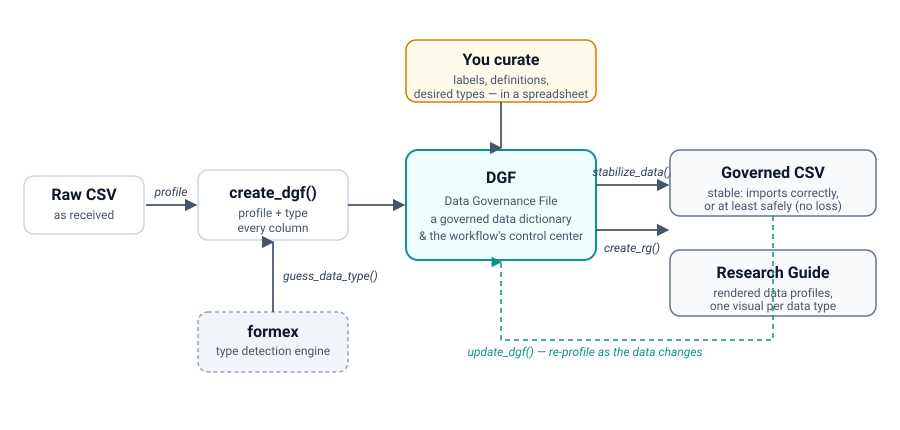

# datagoodr

> Rule-based data governance for the CSV world. Gooder data means gooder research.

`datagoodr` documents, types, and profiles research datasets — turning a bare
CSV into a governed, self-describing data asset and a readable Research Guide.

## The problem: ungoverned data corrupts science and analytics

A CSV carries no schema. Whether `47401` is a ZIP code, a county FIPS, or a count
is invisible — so every tool that opens the file guesses, and they guess
differently. A leading zero is dropped, a date is parsed in the wrong order, a
coded category is averaged as if it were a number. These are not edge cases; they
are the daily reality of applied research and organizational analytics, and they
quietly corrupt findings long before anyone notices.

The discipline that prevents this — **data governance**: protecting, refining,
and responsibly sharing data assets — has been a core concern of information
systems for decades. But it has become urgent in statistics and the social
sciences, where the creation and sharing of new data sources has grown
exponentially while governance practice has not kept pace. The usual answer is an
enterprise data-governance system: a heavyweight platform with complex schemas,
unfamiliar data-type ontologies, and a price tag and staffing model that put it
out of reach for most labs, analysts, and academics. Governance that demands all
of that simply fails to meet most people where they are.

**datagoodr is a feasible alternative.** It is organized around familiar data
types and **CSV files** — the default currency of the scientific world and
organizational analysts — and around a single, legible artifact anyone can edit
in a spreadsheet. Governance becomes a set of named rules attached to your data,
not a platform you have to adopt.

## How it works



At the center is the **Data Governance File (DGF)**: a table with one row per
variable that is both a *governed data dictionary* and the *control center* for
the whole workflow. `create_dgf()` profiles every column and types it (using the
[formex](https://lecy.github.io/formex/) detection engine); you curate the result
in a spreadsheet — adding labels, definitions, and corrected types; and the DGF
then drives two outputs:

- **a stabilized Governed CSV** (`stabilize_data()`) that imports to the correct
  type where possible, and *safely* — without data loss — where not; and
- **a Research Guide** (`create_rg()`): a rendered data profile with a visual
  tuned to each column's type.

As the data changes, `update_dgf()` re-profiles it while preserving everything
you curated.

> **Acronyms.** **DGF** = Data Governance File · **RG** = Research Guide.

## Installation

```r
# datagoodr depends on the formex detection engine
remotes::install_github("lecy/formex")
remotes::install_github("UrbanInstitute/datagoodr")
```

## Documentation

The user guide is being built out as a set of vignettes (Getting Started, the
workflow, rule-based governance, stabilizing datasets, data profiling, research
guides, and documentation). Start with **Rule-Based Data Governance** and
**Guessing Data Types** in the Articles section of the package website, pending
the full set.

## Development plan and current state

datagoodr is under active development. The current cycle **reintegrated the
type-detection layer into [formex](https://github.com/lecy/formex)** and adopted
formex's v7 ontology, so datagoodr is now cleanly *the workflow* and formex is
*the engine*.

**Implemented**

- **Detection extracted to formex.** The ~80 `is_*` detectors, the ontology, and
  `guess_data_type()` now live in formex, which datagoodr imports. datagoodr
  keeps profiling, the DGF, review/override, stabilization, and rendering.
- **A clearer rule vocabulary.** Ingest rules were renamed `as_*` → `read_*` (the
  name now states the format a rule *reads*), with deprecated shims.
- **Dual-modality typing.** `create_dgf()` reads both of formex's predictions
  (the ontology route and the legacy detectors) with a storage-safety gate that
  protects zero-padded keys (FIPS, ZIP, EIN) from being coerced to numbers.
- **The v7 two-axis DGF.** Each column carries a machine `guess_*` leaf
  (`format_style` + `unit_type`), a human-editable `desired_*` target form, and a
  suggested **`stabilizer`** — a `read :: [convert] :: write` plan — previewed in
  `stable_first5`.
- **Executable stabilization.** `stabilize_data(use_v7 = TRUE)` runs those plans
  to produce the governed CSV; legacy rules still take precedence.
- **Profiling + rendering.** Universal quality metrics (distinct, missingness,
  zeros, infinities, duplication) plus type-specific profiles, rendered as a
  Research Guide with per-type visuals (histogram, treemap, calendar heat-map,
  boolean bar, word cloud).

**In progress / planned**

- The full user-guide vignette set (see `dev/vignette-user-guide-plan.md`).
- Porting the render engine off the legacy `desired_data_type`/`desired_data_class`
  columns onto the v7 axes.
- Additional profile metrics (e.g. entropy / categorical balance) under
  consideration.

Planning notes and design rationale live in `dev/` (`formex-reintegration-plan.md`,
`schema-simplification-plan.md`, `v7-dgf-integration-plan.md`).
