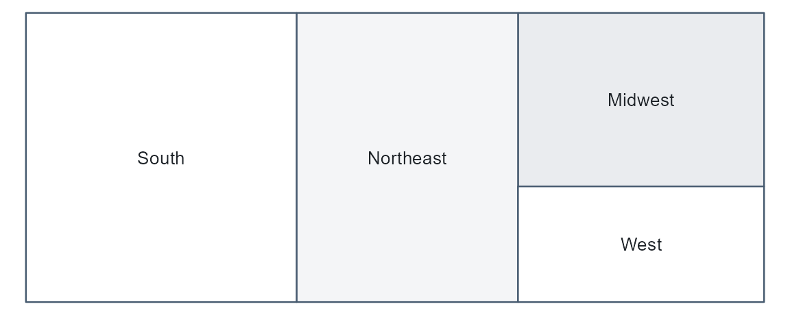

# Profiles and Research Guides

## From a new dataset to documentation, fast

The goal is to get from a raw file to *stable, publishable
documentation* with as little hand work as possible. datagoodr does this
by combining two things: the **formex** typing engine, which classifies
every column automatically, and a set of **default guide templates**,
which know how to render each type. Put them together and a brand-new
dataset has a first, complete Research Guide before you have written a
single label.

``` r

dgf <- create_dgf(raw_data, file = "DGF", open = FALSE)  # type + profile
create_rg(dgf, file = "research-guide")                  # scaffold the guide
```

[`create_rg()`](../reference/create_rg.md) builds a self-contained
report pointed at your DGF. Because the DGF already carries every
column’s profile (the `rg_*` cells), the guide renders from the
governance file alone — the raw data is not needed again.

The guide opens with a numbered contents list and groups variables by
data type. Each variable gets a left rail (data type, label, name,
description, properties) beside its graphic, data preview and stats.
That is the default `"rail"` style. `create_rg(dgf, style = "compact")`
gives the same guide condensed for documentation — the same blocks, but
a one-row properties strip, short tables and preview, smaller graphics
and about half the whitespace, so several variables fit on a screen.
`create_rg(dgf, style = "vintage")` gives the original three-column
grid. [`vignette("report-styles")`](../articles/report-styles.md)
compares the three and shows how to switch;
[`vignette("example-guides")`](../articles/example-guides.md) has
finished guides built from familiar datasets.

## One guide, a different style for each type

A good data profile does not look the same for every column. A
distribution of incomes wants a histogram; a set of regions wants to
show relative share; a date column wants to show coverage over time. The
renderer dispatches on each column’s type and chooses the matching
style:

| type | reporting style | what it shows |
|----|----|----|
| **number** | histogram + quantile table | shape, center, spread, tails |
| **categorical** | treemap + frequency table | levels sized by share |
| **temporal (calendar)** | calendar heat-map | coverage and density over dates |
| **temporal (grain)** | period bars | counts by year / quarter / month |
| **boolean** | two-bar chart | the TRUE / FALSE split |
| **text** | word cloud + length summary | vocabulary and typical length |

So the *same* guide, built from the *same* DGF, presents an income
column, a region column, and a founding-date column each in the form
that reads best — without you choosing any of it.

### The styles, rendered from the demo dataset

Build a DGF from the package’s demo data (one column per type) and
render each column’s graphic with
[`dg_graphic()`](../reference/dg_element.md) — the very function the
guide calls:

``` r

library(datagoodr)
dgf <- create_dgf(dg_demo, file = tempfile("dgf"), open = FALSE)
```

``` r

dg_graphic(dgf, "revenue", label = "")      # number -> histogram
```


``` r

dg_graphic(dgf, "region", label = "")       # categorical -> treemap
```



``` r

dg_graphic(dgf, "is_active", label = "")    # boolean -> two-bar chart
```


``` r

dg_graphic(dgf, "event_date", label = "")   # temporal -> calendar heat-map
```


``` r

dg_graphic(dgf, "notes", label = "")        # text -> word cloud
```


Five columns, five styles, one line each — and all chosen automatically
from the type. (An identifier such as `county_fips` has no graphic by
design; it is summarized in its profile table instead.)

## Typing quality drives guide quality

Because the style follows the type, the guide is only as good as the
typing. A column mistyped as text renders as a word cloud when it wanted
a histogram. This is why datagoodr records *how confident* each guess is
and leaves the final say to you: confirm the easy ones, correct the few
that matter, and the guide re-renders in the right style.

For how the types are guessed — the two-axis leaf, the honesty columns,
and the storage-safety gate — see **Guessing Data Types**.

## Iterate

The guide is regenerated from the DGF, so improving documentation is a
loop: curate a label or fix a type, re-profile with
[`update_dgf()`](../reference/update_dgf.md), and re-render. Nothing you
hand-edited is lost. For customizing layout, formatting, and narrative
around the generated sections,
[`create_rg()`](../reference/create_rg.md) scaffolds an editable project
(a Quarto document plus a `DG.R` you can override) — see the package
reference.

## Next

- **Documenting Data with the DGF** — adding the human meaning (labels,
  factor level definitions) that turns an auto-profiled guide into
  finished documentation.
