<!-- datagoodr research guide template.

     Customize without editing the package:
       - DG.R           custom functions & layout overrides
       - datagoodr.css  the page grid, fonts, and colors
     See vignette("customizing", package = "datagoodr").

     Render from the console with:  quarto::quarto_render("research-guide.qmd")
     or re-render against a different DGF/dataset without editing this file:
       datagoodr::update_rg("research-guide.qmd", DGF = "DGF-V2.xlsx") -->

<br>


<br><br>


## Logical


## Factor

 

::: {.div1} 

#### nameLast

<p class="dg-vlabel">last name</p>

::: 

::::: {.parent} 

::: {.div3} 


<div class="dg-field"><span class="dg-k">DATA MODE</span><span class="dg-v">categorical</span></div>


<div class="dg-field"><span class="dg-k">DATA TYPE</span><span class="dg-v">geographic</span></div>


<div class="dg-field"><span class="dg-k">MAX NCHAR</span><span class="dg-v">14</span></div>


::: 

::: {.div4} 


<div class="dg-field"><span class="dg-k">DESCRIPTION</span><span class="dg-v">Player's last name</span></div>


::: 

::: {.div5} 

**PREVIEW**:


::: 

::: {.div6} 

<pre class="dg-preview">
Johnson · Perez · Martinez · Jones · Davis · Wilson · Hernandez
Rodriguez · Smith · Williams · Gonzalez · Ramirez · Young · Anderson
Brown · Miller · Garcia · Sanchez · Castillo · Cruz · Jackson
Lopez · Thompson · Walker · Pena · Bell · Cabrera · Clark · Hill

</pre>


::: 

::: {.div7} 

**PROPERTIES**: 

|STAT     |   VAL|     PER| 
 |:--------|-----:|-------:| 
 |Rows     | 4,620|        | 
 |Distinct | 3,099| (67.1%)| 


::: 

::: {.div8} 

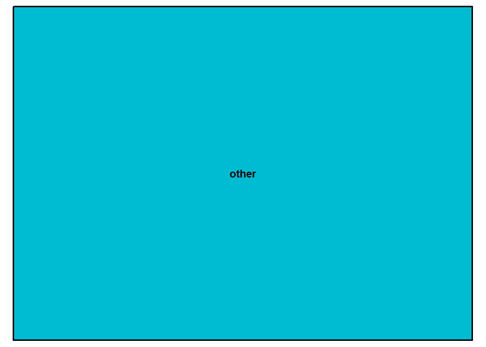{width=672}


::: 

::: {.div9} 

**FACTOR LEVELS**:

| Frequency|    (%)|Label     | 
 |---------:|------:|:---------| 
 |        28| (0.6%)|Johnson   | 
 |        28| (0.6%)|Perez     | 
 |        26| (0.6%)|Martinez  | 
 |        25| (0.5%)|Jones     | 
 |        24| (0.5%)|Davis     | 
 |        24| (0.5%)|Wilson    | 
 |        21| (0.5%)|Hernandez | 
 |        19| (0.4%)|Rodriguez | 
 |        19| (0.4%)|Smith     | 
 |        19| (0.4%)|Williams  | 
 |        18| (0.4%)|Gonzalez  | 
 |        18| (0.4%)|Ramirez   | 
 |        17| (0.4%)|Young     | 
 |        16| (0.3%)|Anderson  | 
 |        16| (0.3%)|Brown     | 
 |        16| (0.3%)|Miller    | 
 |        15| (0.3%)|Garcia    | 
 |        14| (0.3%)|Sanchez   | 
 |        12| (0.3%)|Castillo  | 
 |        12| (0.3%)|Cruz      | 
 |        12| (0.3%)|Jackson   | 
 |        12| (0.3%)|Lopez     | 
 |        12| (0.3%)|Thompson  | 
 |        12| (0.3%)|Walker    | 
 |        11| (0.2%)|Pena      | 
 |        10| (0.2%)|Bell      | 
 |        10| (0.2%)|Cabrera   | 
 |        10| (0.2%)|Clark     | 
 |        10| (0.2%)|Hill      | 
 |        10| (0.2%)|Reed      | 
 |         9| (0.2%)|Diaz      | 
 |         9| (0.2%)|Harris    | 
 |         9| (0.2%)|Moore     | 
 |         9| (0.2%)|Ortiz     | 
 |         9| (0.2%)|Rivera    | 
 |         9| (0.2%)|White     | 
 |         9| (0.2%)|Wright    | 
 |         8| (0.2%)|Alvarez   | 
 |         8| (0.2%)|Green     | 
 |         8| (0.2%)|Lee       | 
 |         8| (0.2%)|Murphy    | 
 |         8| (0.2%)|Wood      | 
 |         7| (0.2%)|Adams     | 
 |         7| (0.2%)|Hall      | 
 |         7| (0.2%)|Lewis     | 
 |         7| (0.2%)|Morris    | 
 |         7| (0.2%)|Myers     | 
 |         7| (0.2%)|Patterson | 
 |         7| (0.2%)|Powell    | 
 |         7| (0.2%)|Reyes     | 


::: 

:::::  


 

::: {.div1} 

#### birthCity

<p class="dg-vlabel">city of birth</p>

::: 

::::: {.parent} 

::: {.div3} 


<div class="dg-field"><span class="dg-k">DATA MODE</span><span class="dg-v">categorical</span></div>


<div class="dg-field"><span class="dg-k">DATA TYPE</span><span class="dg-v">geographic</span></div>


<div class="dg-field"><span class="dg-k">MAX NCHAR</span><span class="dg-v">25</span></div>


::: 

::: {.div4} 


<div class="dg-field"><span class="dg-k">DESCRIPTION</span><span class="dg-v">City where the player was born; blank if unknown</span></div>


::: 

::: {.div5} 

**PREVIEW**:


::: 

::: {.div6} 

<pre class="dg-preview">
Santo Domingo · Los Angeles · Houston · San Pedro de Macoris
San Diego · Cincinnati · Chicago · Tampa · Dallas · Long Beach
Miami · Atlanta · Caracas · Sacramento · Portland · San Cristobal
Oakland · Rio Piedras · Valencia · Jacksonville · San Jose

</pre>


::: 

::: {.div7} 

**PROPERTIES**: 

|STAT       |   VAL|     PER| 
 |:----------|-----:|-------:| 
 |Rows       | 4,620|        | 
 |Distinct   | 1,577| (34.1%)| 
 |Missing/NA |     1|  (0.0%)| 


::: 

::: {.div8} 

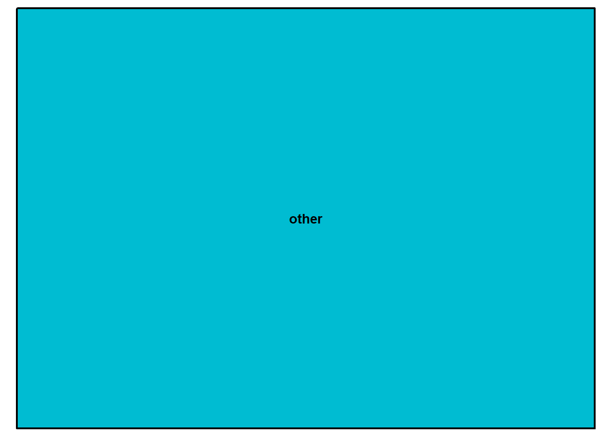{width=672}


::: 

::: {.div9} 

**FACTOR LEVELS**:

| Frequency|    (%)|Label                | 
 |---------:|------:|:--------------------| 
 |        89| (1.9%)|Santo Domingo        | 
 |        71| (1.5%)|Los Angeles          | 
 |        61| (1.3%)|Houston              | 
 |        53| (1.1%)|San Pedro de Macoris | 
 |        50| (1.1%)|San Diego            | 
 |        37| (0.8%)|Cincinnati           | 
 |        36| (0.8%)|Chicago              | 
 |        35| (0.8%)|Tampa                | 
 |        33| (0.7%)|Dallas               | 
 |        31| (0.7%)|Long Beach           | 
 |        30| (0.6%)|Miami                | 
 |        29| (0.6%)|Atlanta              | 
 |        29| (0.6%)|Caracas              | 
 |        26| (0.6%)|Sacramento           | 
 |        25| (0.5%)|Portland             | 
 |        24| (0.5%)|San Cristobal        | 
 |        23| (0.5%)|Oakland              | 
 |        23| (0.5%)|Rio Piedras          | 
 |        23| (0.5%)|Valencia             | 
 |        22| (0.5%)|Jacksonville         | 
 |        22| (0.5%)|San Jose             | 
 |        21| (0.5%)|Brooklyn             | 
 |        21| (0.5%)|Columbus             | 
 |        20| (0.4%)|La Habana            | 
 |        20| (0.4%)|New York             | 
 |        20| (0.4%)|Santiago             | 
 |        19| (0.4%)|Detroit              | 
 |        19| (0.4%)|Maracaibo            | 
 |        19| (0.4%)|St. Louis            | 
 |        18| (0.4%)|Philadelphia         | 
 |        17| (0.4%)|Austin               | 
 |        17| (0.4%)|Cleveland            | 
 |        17| (0.4%)|Las Vegas            | 
 |        16| (0.3%)|Baltimore            | 
 |        16| (0.3%)|Louisville           | 
 |        16| (0.3%)|San Francisco        | 
 |        16| (0.3%)|Santa Monica         | 
 |        16| (0.3%)|Seattle              | 
 |        15| (0.3%)|Bani                 | 
 |        15| (0.3%)|Fullerton            | 
 |        15| (0.3%)|Kansas City          | 
 |        15| (0.3%)|Maracay              | 
 |        15| (0.3%)|Memphis              | 
 |        15| (0.3%)|Orange               | 
 |        14| (0.3%)|Birmingham           | 
 |        14| (0.3%)|Fort Worth           | 
 |        14| (0.3%)|La Romana            | 
 |        14| (0.3%)|Oklahoma City        | 
 |        14| (0.3%)|Pasadena             | 
 |        14| (0.3%)|San Juan             | 


::: 

:::::  


 

::: {.div1} 

#### bats

<p class="dg-vlabel">side of plate (R/L/B)</p>

::: 

::::: {.parent} 

::: {.div3} 


<div class="dg-field"><span class="dg-k">DATA MODE</span><span class="dg-v">categorical</span></div>


<div class="dg-field"><span class="dg-k">DATA TYPE</span><span class="dg-v">unordered</span></div>


<div class="dg-field"><span class="dg-k">MAX NCHAR</span><span class="dg-v"> 1</span></div>


::: 

::: {.div4} 


<div class="dg-field"><span class="dg-k">DESCRIPTION</span><span class="dg-v">Player's batting hand, coded R (right), L (left) or B (both)</span></div>


::: 

::: {.div5} 

**PREVIEW**:


::: 

::: {.div6} 

<pre class="dg-preview">
R · L · B

</pre>


::: 

::: {.div7} 

**PROPERTIES**: 

|STAT     |   VAL|    PER| 
 |:--------|-----:|------:| 
 |Rows     | 4,620|       | 
 |Distinct |     3| (0.1%)| 


::: 

::: {.div8} 

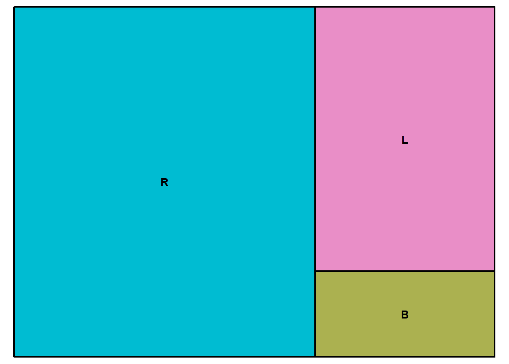{width=672}


::: 

::: {.div9} 

**FACTOR LEVELS**:

| Frequency|     (%)|Label |Meaning   | 
 |---------:|-------:|:-----|:---------| 
 |     2,895| (62.7%)|R     |R (right) | 
 |     1,303| (28.2%)|L     |L (left)  | 
 |       422|  (9.1%)|B     |B (both)  | 


::: 

:::::  


 

::: {.div1} 

#### throws

<p class="dg-vlabel">throwing hand (L/R)</p>

::: 

::::: {.parent} 

::: {.div3} 


<div class="dg-field"><span class="dg-k">DATA MODE</span><span class="dg-v">categorical</span></div>


<div class="dg-field"><span class="dg-k">DATA TYPE</span><span class="dg-v">unordered</span></div>


<div class="dg-field"><span class="dg-k">MAX NCHAR</span><span class="dg-v"> 1</span></div>


::: 

::: {.div4} 


<div class="dg-field"><span class="dg-k">DESCRIPTION</span><span class="dg-v">Player's throwing hand, coded R (right) or L (left)</span></div>


::: 

::: {.div5} 

**PREVIEW**:


::: 

::: {.div6} 

<pre class="dg-preview">
R · L

</pre>


::: 

::: {.div7} 

**PROPERTIES**: 

|STAT     |   VAL|    PER| 
 |:--------|-----:|------:| 
 |Rows     | 4,620|       | 
 |Distinct |     2| (0.0%)| 


::: 

::: {.div8} 

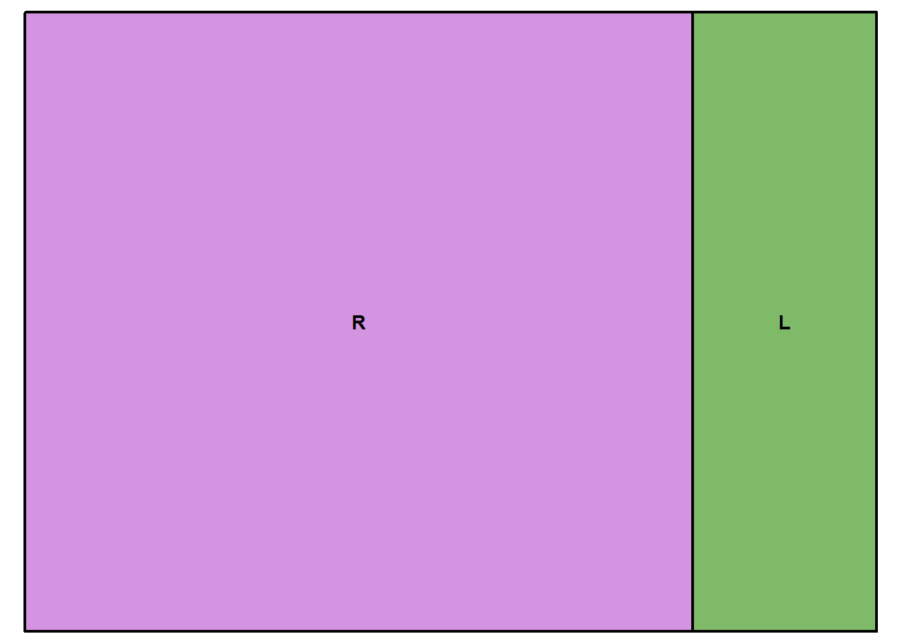{width=672}


::: 

::: {.div9} 

**FACTOR LEVELS**:

| Frequency|     (%)|Label |Meaning   | 
 |---------:|-------:|:-----|:---------| 
 |     3,624| (78.4%)|R     |R (right) | 
 |       996| (21.6%)|L     |L (left)  | 


::: 

:::::  

## Numeric 

 

::: {.div1} 

#### weight

<p class="dg-vlabel">weight (lbs)</p>

::: 

::::: {.parent} 

::: {.div3} 


<div class="dg-field"><span class="dg-k">DATA MODE</span><span class="dg-v">number</span></div>


<div class="dg-field"><span class="dg-k">DATA TYPE</span><span class="dg-v">measurement</span></div>


<div class="dg-field"><span class="dg-k">MAX NCHAR</span><span class="dg-v"> 3</span></div>


::: 

::: {.div4} 


<div class="dg-field"><span class="dg-k">DESCRIPTION</span><span class="dg-v">Player's weight in pounds</span></div>


::: 

::: {.div5} 

**PREVIEW**:


::: 

::: {.div6} 

<pre class="dg-preview">
200 · 190 · 185 · 195 · 180 · 205 · 210 · 215 · 175 · 220 · 170
225 · 230 · 235 · 165 · 240 · 160 · 245 · 250 · 155 · 150 · 192
172 · 255 · 260 · 178 · 187 · 212 · 186 · 193 · 198 · 207 · 217
218 · 270 · 188 · 197 · 202 · 194 · 213 · 265 · 166 · 209 · 174

</pre>


::: 

::: {.div7} 

**PROPERTIES**: 

|STAT     |   VAL|    PER| 
 |:--------|-----:|------:| 
 |Rows     | 4,620|       | 
 |Distinct |   111| (2.4%)| 


::: 

::: {.div8} 

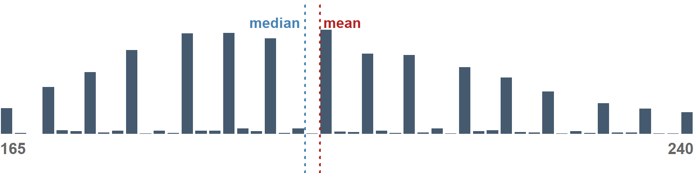{width=768}


::: 

::: {.div9} 

**STATS**:

| MIN| MAX|   MEAN| Q05| Q25| Q50| Q75| Q95| 
 |---:|---:|------:|---:|---:|---:|---:|---:| 
 | 140| 315| 199.58| 165| 185| 198| 215| 240| 


**DISTRIBUTION SHAPE**:

::: {.dg-shape}

|stat     |  num|interpretation | 
 |:--------|----:|:--------------| 
 |Skew     | 0.56|MED            | 
 |Kurtosis | 0.57|LOW            | 


::: 


::: 

:::::  


 

::: {.div1} 

#### height

<p class="dg-vlabel">height (inches)</p>

::: 

::::: {.parent} 

::: {.div3} 


<div class="dg-field"><span class="dg-k">DATA MODE</span><span class="dg-v">number</span></div>


<div class="dg-field"><span class="dg-k">DATA TYPE</span><span class="dg-v">rank</span></div>


<div class="dg-field"><span class="dg-k">MAX NCHAR</span><span class="dg-v"> 2</span></div>


::: 

::: {.div4} 


<div class="dg-field"><span class="dg-k">DESCRIPTION</span><span class="dg-v">Player's height in inches</span></div>


::: 

::: {.div5} 

**PREVIEW**:


::: 

::: {.div6} 

<pre class="dg-preview">
74 · 73 · 72 · 75 · 76 · 71 · 70 · 77 · 69 · 78 · 79 · 68 · 67 · 80
66 · 82 · 81 · 83

</pre>


::: 

::: {.div7} 

**PROPERTIES**: 

|STAT     |   VAL|    PER| 
 |:--------|-----:|------:| 
 |Rows     | 4,620|       | 
 |Distinct |    18| (0.4%)| 


::: 

::: {.div8} 

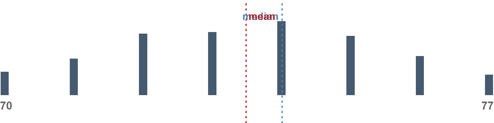{width=768}


::: 

::: {.div9} 

**STATS**:

| MIN| MAX|  MEAN| Q05| Q25| Q50| Q75| Q95| 
 |---:|---:|-----:|---:|---:|---:|---:|---:| 
 |  66|  83| 73.49|  70|  72|  74|  75|  77| 


**DISTRIBUTION SHAPE**:

::: {.dg-shape}

|stat     |  num|interpretation | 
 |:--------|----:|:--------------| 
 |Skew     | 0.01|LOW            | 
 |Kurtosis | 0.18|LOW            | 


::: 


::: 

:::::  


 

::: {.div1} 

#### G

<p class="dg-vlabel">games</p>

::: 

::::: {.parent} 

::: {.div3} 


<div class="dg-field"><span class="dg-k">DATA MODE</span><span class="dg-v">number</span></div>


<div class="dg-field"><span class="dg-k">MAX NCHAR</span><span class="dg-v"> 3</span></div>


::: 

::: {.div4} 


<div class="dg-field"><span class="dg-k">DESCRIPTION</span><span class="dg-v">Average game appearances per season</span></div>


::: 

::: {.div5} 

**PREVIEW**:


::: 

::: {.div6} 

<pre class="dg-preview">
30 · 32 · 28 · 26 · 29 · 24 · 31 · 27 · 34 · 48 · 50 · 40 · 25 · 33
46 · 36 · 54 · 38 · 22 · 42 · 35 · 39 · 52 · 56 · 23 · 60 · 20 · 37
44 · 18 · 43 · 62 · 14 · 41 · 53 · 55 · 19 · 13 · 64 · 16 · 47 · 49
51 · 45 · 57 · 21 · 58 · 59 · 12 · 17 · 72 · 100 · 108 · 11 · 15

</pre>


::: 

::: {.div7} 

**PROPERTIES**: 

|STAT     |   VAL|    PER| 
 |:--------|-----:|------:| 
 |Rows     | 4,620|       | 
 |Distinct |   149| (3.2%)| 


::: 

::: {.div8} 

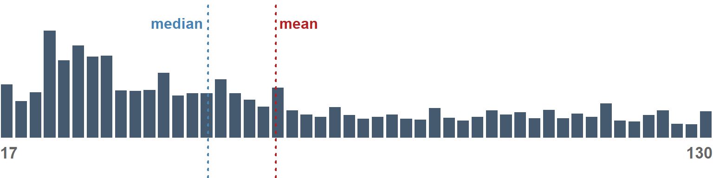{width=768}


::: 

::: {.div9} 

**STATS**:

| MIN| MAX|  MEAN| Q05| Q25| Q50| Q75| Q95| 
 |---:|---:|-----:|---:|---:|---:|---:|---:| 
 |  11| 159| 60.73|  17|  30|  50|  89| 130| 


**DISTRIBUTION SHAPE**:

::: {.dg-shape}

|stat     |   num|interpretation | 
 |:--------|-----:|:--------------| 
 |Skew     |   0.7|MED            | 
 |Kurtosis | -0.64|LOW            | 


::: 


::: 

:::::  


 

::: {.div1} 

#### AB

<p class="dg-vlabel">at bats</p>

::: 

::::: {.parent} 

::: {.div3} 


<div class="dg-field"><span class="dg-k">DATA MODE</span><span class="dg-v">number</span></div>


<div class="dg-field"><span class="dg-k">DATA TYPE</span><span class="dg-v">measurement</span></div>


<div class="dg-field"><span class="dg-k">MAX NCHAR</span><span class="dg-v"> 3</span></div>


::: 

::: {.div4} 


<div class="dg-field"><span class="dg-k">DESCRIPTION</span><span class="dg-v">Average at bats per season; blank if the player has no recorded at bats</span></div>


::: 

::: {.div5} 

**PREVIEW**:


::: 

::: {.div6} 

<pre class="dg-preview">
1 · 2 · 3 · 4 · 5 · 6 · 12 · 30 · 7 · 9 · 10 · 48 · 8 · 17 · 26 · 38
14 · 16 · 36 · 20 · 42 · 21 · 40 · 50 · 23 · 32 · 11 · 29 · 41 · 44
46 · 22 · 47 · 24 · 28 · 34 · 39 · 52 · 54 · 160 · 15 · 33 · 35 · 45
56 · 19 · 13 · 18 · 31 · 55 · 128 · 252 · 81 · 86 · 120 · 25 · 37

</pre>


::: 

::: {.div7} 

**PROPERTIES**: 

|STAT       |   VAL|     PER| 
 |:----------|-----:|-------:| 
 |Rows       | 4,620|        | 
 |Distinct   |   581| (12.6%)| 
 |Missing/NA |   633| (13.7%)| 


::: 

::: {.div8} 

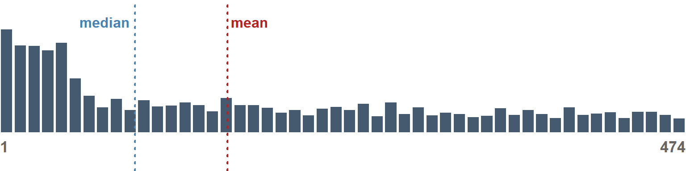{width=768}


::: 

::: {.div9} 

**STATS**:

| MIN| MAX|   MEAN| Q05| Q25| Q50| Q75| Q95| 
 |---:|---:|------:|---:|---:|---:|---:|---:| 
 |   1| 634| 157.74|   1|  12|  94| 276| 474| 


**DISTRIBUTION SHAPE**:

::: {.dg-shape}

|stat     |   num|interpretation | 
 |:--------|-----:|:--------------| 
 |Skew     |  0.84|MED            | 
 |Kurtosis | -0.53|LOW            | 


::: 


::: 

:::::  


 

::: {.div1} 

#### H

<p class="dg-vlabel">hits</p>

::: 

::::: {.parent} 

::: {.div3} 


<div class="dg-field"><span class="dg-k">DATA MODE</span><span class="dg-v">number</span></div>


<div class="dg-field"><span class="dg-k">MAX NCHAR</span><span class="dg-v"> 3</span></div>


::: 

::: {.div4} 


<div class="dg-field"><span class="dg-k">DESCRIPTION</span><span class="dg-v">Average hits per season</span></div>


::: 

::: {.div5} 

**PREVIEW**:


::: 

::: {.div6} 

<pre class="dg-preview">
0 · 1 · 2 · 4 · 3 · 5 · 6 · 8 · 7 · 10 · 20 · 16 · 22 · 32 · 24 · 34
28 · 12 · 60 · 14 · 29 · 37 · 42 · 56 · 26 · 38 · 41 · 21 · 36 · 70
18 · 33 · 40 · 44 · 54 · 67 · 13 · 30 · 82 · 46 · 47 · 61 · 62 · 69
72 · 88 · 100 · 11 · 17 · 19 · 49 · 52 · 115 · 9 · 23 · 31 · 39 · 48

</pre>


::: 

::: {.div7} 

**PROPERTIES**: 

|STAT     |   VAL|     PER| 
 |:--------|-----:|-------:| 
 |Rows     | 4,620|        | 
 |Distinct |   181|  (3.9%)| 
 |Zero     | 1,479| (32.0%)| 


::: 

::: {.div8} 

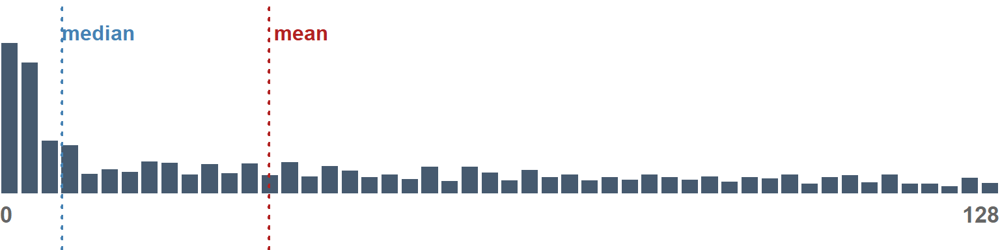{width=768}


::: 

::: {.div9} 

**STATS**:

| MIN| MAX|  MEAN| Q05| Q25| Q50| Q75| Q95| 
 |---:|---:|-----:|---:|---:|---:|---:|---:| 
 |   0| 197| 34.42|   0|   0|   8|  61| 128| 


**DISTRIBUTION SHAPE**:

::: {.dg-shape}

|stat     |  num|interpretation | 
 |:--------|----:|:--------------| 
 |Skew     |  1.2|HIGH           | 
 |Kurtosis | 0.33|LOW            | 


::: 


::: 

:::::  


 

::: {.div1} 

#### AVG

<p class="dg-vlabel">batting average</p>

::: 

::::: {.parent} 

::: {.div3} 


<div class="dg-field"><span class="dg-k">DATA MODE</span><span class="dg-v">number</span></div>


<div class="dg-field"><span class="dg-k">DATA TYPE</span><span class="dg-v">measurement</span></div>


<div class="dg-field"><span class="dg-k">MAX NCHAR</span><span class="dg-v">19</span></div>


::: 

::: {.div4} 


<div class="dg-field"><span class="dg-k">DESCRIPTION</span><span class="dg-v">Career batting average (hits / at bats over all seasons); blank if the player has no recorded at bats</span></div>


::: 

::: {.div5} 

**PREVIEW**:


::: 

::: {.div6} 

<pre class="dg-preview">
0 · 0.25 · 0.166666666666667 · 0.333333333333333
0.0833333333333333 · 0.2 · 0.5 · 1 · 0.111111111111111 · 0.125
0.142857142857143 · 0.0625 · 0.133333333333333 · 0.0666666666666667
0.1 · 0.0714285714285714 · 0.05 · 0.208333333333333

</pre>


::: 

::: {.div7} 

**PROPERTIES**: 

|STAT       |   VAL|     PER| 
 |:----------|-----:|-------:| 
 |Rows       | 4,620|        | 
 |Distinct   | 2,908| (62.9%)| 
 |Missing/NA |   633| (13.7%)| 
 |Zero       |   548| (11.9%)| 


::: 

::: {.div8} 

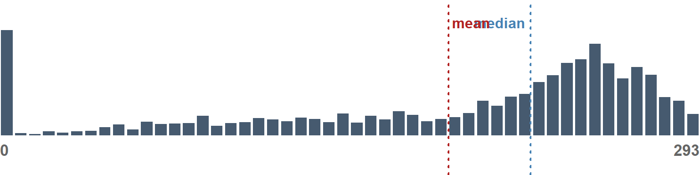{width=768}


::: 

::: {.div9} 

**STATS**:

| MIN| MAX| MEAN| Q05|  Q25|  Q50|  Q75|  Q95| 
 |---:|---:|----:|---:|----:|----:|----:|----:| 
 |   0|   1| 0.19|   0| 0.11| 0.22| 0.26| 0.29| 


**DISTRIBUTION SHAPE**:

::: {.dg-shape}

|stat     |   num|interpretation | 
 |:--------|-----:|:--------------| 
 |Skew     |  1.31|HIGH           | 
 |Kurtosis | 10.28|HIGH           | 


::: 


::: 

:::::  


 

::: {.div1} 

#### SLUG

<p class="dg-vlabel">slugging percentage</p>

::: 

::::: {.parent} 

::: {.div3} 


<div class="dg-field"><span class="dg-k">DATA MODE</span><span class="dg-v">number</span></div>


<div class="dg-field"><span class="dg-k">DATA TYPE</span><span class="dg-v">measurement</span></div>


<div class="dg-field"><span class="dg-k">MAX NCHAR</span><span class="dg-v">19</span></div>


::: 

::: {.div4} 


<div class="dg-field"><span class="dg-k">DESCRIPTION</span><span class="dg-v">Career slugging percentage (total bases / at bats over all seasons); blank if the player has no recorded at bats</span></div>


::: 

::: {.div5} 

**PREVIEW**:


::: 

::: {.div6} 

<pre class="dg-preview">
0 · 0.333333333333333 · 0.25 · 0.5 · 0.0833333333333333 · 0.2
0.166666666666667 · 1 · 0.111111111111111 · 0.142857142857143
0.0714285714285714 · 0.1 · 0.133333333333333 · 0.0625
0.0666666666666667 · 0.125 · 0.4 · 0.666666666666667

</pre>


::: 

::: {.div7} 

**PROPERTIES**: 

|STAT       |   VAL|     PER| 
 |:----------|-----:|-------:| 
 |Rows       | 4,620|        | 
 |Distinct   | 2,962| (64.1%)| 
 |Missing/NA |   633| (13.7%)| 
 |Zero       |   548| (11.9%)| 


::: 

::: {.div8} 

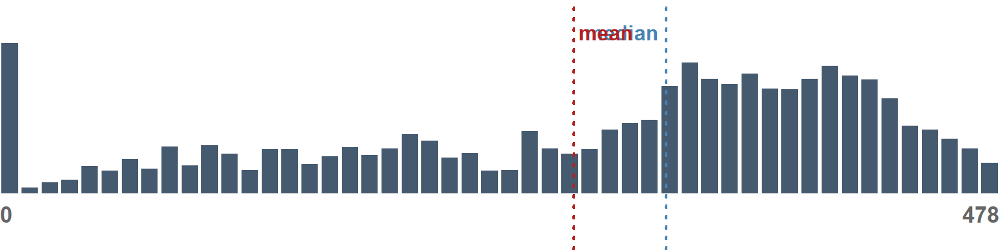{width=768}


::: 

::: {.div9} 

**STATS**:

| MIN| MAX| MEAN| Q05|  Q25|  Q50|  Q75|  Q95| 
 |---:|---:|----:|---:|----:|----:|----:|----:| 
 |   0|   4| 0.27|   0| 0.14| 0.32| 0.39| 0.48| 


**DISTRIBUTION SHAPE**:

::: {.dg-shape}

|stat     |   num|interpretation | 
 |:--------|-----:|:--------------| 
 |Skew     |  2.99|HIGH           | 
 |Kurtosis | 49.33|HIGH           | 


::: 


::: 

:::::  


 

::: {.div1} 

#### salary

::: 

::::: {.parent} 

::: {.div3} 


<div class="dg-field"><span class="dg-k">DATA MODE</span><span class="dg-v">number</span></div>


<div class="dg-field"><span class="dg-k">DATA TYPE</span><span class="dg-v">usd</span></div>


<div class="dg-field"><span class="dg-k">MAX NCHAR</span><span class="dg-v"> 8</span></div>


::: 

::: {.div4} 


<div class="dg-field"><span class="dg-k">DESCRIPTION</span><span class="dg-v">Average annual salary over the player's career, in US dollars (written $851,950)</span></div>


::: 

::: {.div5} 

**PREVIEW**:


::: 

::: {.div6} 

<pre class="dg-preview">
$109,000 · $200,000 · $507,500 · $100,000 · $170,000 · $300,000
$400,000 · $150,000 · $510,000 · $509,500 · $512,500 · $62,500
$390,000 · $125,000 · $380,000 · $414,000 · $120,000 · $250,000
$508,500 · $60,000 · $140,000 · $480,000 · $520,000 · $215,000

</pre>


::: 

::: {.div7} 

**PROPERTIES**: 

|STAT     |   VAL|     PER| 
 |:--------|-----:|-------:| 
 |Rows     | 4,620|        | 
 |Distinct | 3,408| (73.8%)| 


::: 

::: {.div8} 

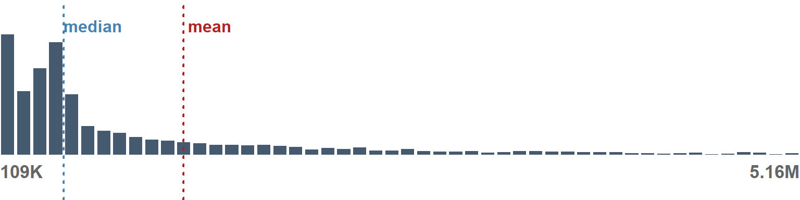{width=768}


::: 

::: {.div9} 

**STATS**:

|    MIN|     MAX|      MEAN|     Q05|   Q25|     Q50|       Q75|       Q95| 
 |------:|-------:|---------:|-------:|-----:|-------:|---------:|---------:| 
 | 60,000| 2.2e+07| 1,269,244| 109,000| 3e+05| 512,500| 1,376,783| 5,161,559| 


**DISTRIBUTION SHAPE**:

::: {.dg-shape}

|stat     |   num|interpretation | 
 |:--------|-----:|:--------------| 
 |Skew     |  3.35|HIGH           | 
 |Kurtosis | 14.98|HIGH           | 


::: 


::: 

:::::  

## Character

 

::: {.div1} 

#### nameFirst

<p class="dg-vlabel">first name</p>

::: 

::::: {.parent} 

::: {.div3} 


<div class="dg-field"><span class="dg-k">DATA MODE</span><span class="dg-v">text</span></div>


<div class="dg-field"><span class="dg-k">DATA TYPE</span><span class="dg-v">person</span></div>


<div class="dg-field"><span class="dg-k">MAX NCHAR</span><span class="dg-v">11</span></div>


::: 

::: {.div4} 


<div class="dg-field"><span class="dg-k">DESCRIPTION</span><span class="dg-v">Player's first name</span></div>


::: 

::: {.div5} 

**PREVIEW**:


::: 

::: {.div6} 

<pre class="dg-preview">
Mike · Chris · Jeff · John · Matt · Scott · Jose · Brian · Mark
Steve · Kevin · Jason · Dave · Joe · Ryan · Tim · David · Jim
Carlos · Luis · Tom · Bob · Tony · Eric · Bill · Greg · Dan · Josh
Brandon · Brad · Rick · Alex · Michael · Juan · Paul · Todd · Doug

</pre>


::: 

::: {.div7} 

**PROPERTIES**: 

|STAT     |   VAL|     PER| 
 |:--------|-----:|-------:| 
 |Rows     | 4,620|        | 
 |Distinct | 1,012| (21.9%)| 


::: 

::: {.div8} 

{width=768}


::: 

::: {.div9} 

**MOST COMMON VALUES**: 

|Value | Frequency|    (%)| 
 |:-----|---------:|------:| 
 |Mike  |       160| (3.5%)| 
 |Chris |        85| (1.8%)| 
 |Jeff  |        81| (1.8%)| 
 |John  |        75| (1.6%)| 
 |Matt  |        74| (1.6%)| 
 |Scott |        68| (1.5%)| 


::: 

:::::  


 

::: {.div1} 

#### birthState

<p class="dg-vlabel">state of birth</p>

::: 

::::: {.parent} 

::: {.div3} 


<div class="dg-field"><span class="dg-k">DATA MODE</span><span class="dg-v">text</span></div>


<div class="dg-field"><span class="dg-k">MAX NCHAR</span><span class="dg-v">22</span></div>


::: 

::: {.div4} 


<div class="dg-field"><span class="dg-k">DESCRIPTION</span><span class="dg-v">State or province where the player was born: a two-letter postal code for US states, a region name elsewhere (e.g. La Romana); blank if unknown</span></div>


::: 

::: {.div5} 

**PREVIEW**:


::: 

::: {.div6} 

<pre class="dg-preview">
CA · TX · FL · NY · IL · OH · PA · GA · Distrito Nacional · MI · VA
LA · NJ · NC · IN · MO · TN · AL · WA · MA · San Pedro de Macoris
KY · OK · MS · SC · OR · MD · AZ · San Cristobal · Carabobo · CT
MN · Distrito Federal · IA · KS · WI · Zulia · CO · HI · ON

</pre>


::: 

::: {.div7} 

**PROPERTIES**: 

|STAT       |   VAL|    PER| 
 |:----------|-----:|------:| 
 |Rows       | 4,620|       | 
 |Distinct   |   210| (4.5%)| 
 |Missing/NA |   167| (3.6%)| 


::: 

::: {.div8} 

{width=768}


::: 

::: {.div9} 

**MOST COMMON VALUES**: 

|Value | Frequency|     (%)| 
 |:-----|---------:|-------:| 
 |CA    |       826| (17.9%)| 
 |TX    |       293|  (6.3%)| 
 |FL    |       260|  (5.6%)| 
 |NY    |       155|  (3.4%)| 
 |IL    |       154|  (3.3%)| 
 |OH    |       150|  (3.2%)| 


::: 

:::::  

## Identifier


## Temporal

 

::: {.div1} 

#### birthDate

<p class="dg-vlabel">date of birth</p>

::: 

::::: {.parent} 

::: {.div3} 


<div class="dg-field"><span class="dg-k">DATA MODE</span><span class="dg-v">temporal</span></div>


<div class="dg-field"><span class="dg-k">DATA TYPE</span><span class="dg-v">calendar</span></div>


<div class="dg-field"><span class="dg-k">MAX NCHAR</span><span class="dg-v">12</span></div>


::: 

::: {.div4} 


<div class="dg-field"><span class="dg-k">DESCRIPTION</span><span class="dg-v">Player's birth date, written Mon DD, YYYY (e.g. Dec 27, 1981)</span></div>


::: 

::: {.div5} 

**PREVIEW**:


::: 

::: {.div6} 

<pre class="dg-preview">
Mar 25, 1969 · Mar 05, 1971 · May 11, 1964 · Dec 07, 1963
Jul 15, 1980 · Nov 23, 1971 · Oct 21, 1979 · Apr 05, 1976
Apr 08, 1983 · Apr 10, 1963 · Apr 11, 1972 · Apr 14, 1966
Apr 18, 1959 · Apr 18, 1990 · Apr 19, 1977 · Apr 19, 1983

</pre>


::: 

::: {.div7} 

**PROPERTIES**: 

|STAT     |   VAL|     PER| 
 |:--------|-----:|-------:| 
 |Rows     | 4,620|        | 
 |Distinct | 3,965| (85.8%)| 


::: 

::: {.div8} 

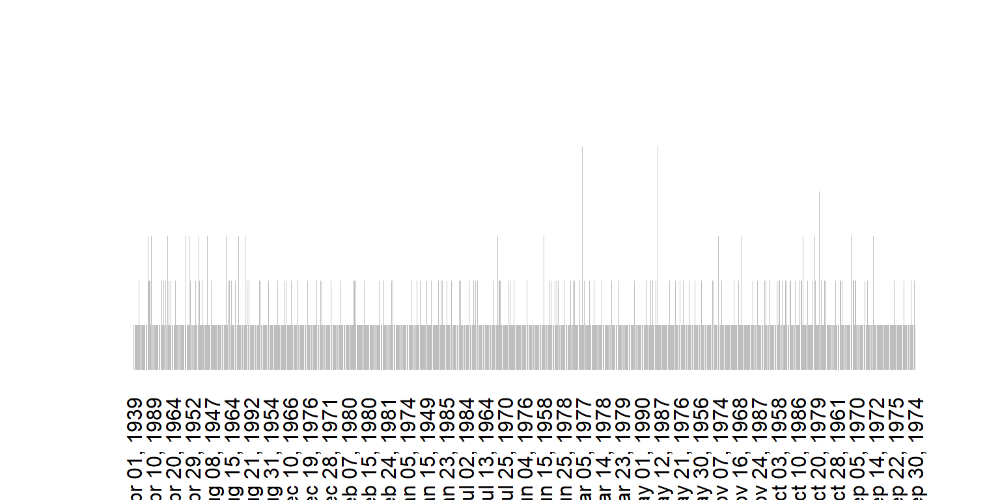{width=768}


::: 

:::::  


 

::: {.div1} 

#### birthYear

<p class="dg-vlabel">year of birth</p>

::: 

::::: {.parent} 

::: {.div3} 


<div class="dg-field"><span class="dg-k">DATA MODE</span><span class="dg-v">temporal</span></div>


<div class="dg-field"><span class="dg-k">DATA TYPE</span><span class="dg-v">year</span></div>


<div class="dg-field"><span class="dg-k">MAX NCHAR</span><span class="dg-v"> 4</span></div>


::: 

::: {.div4} 


<div class="dg-field"><span class="dg-k">DESCRIPTION</span><span class="dg-v">Year in which the player was born (YYYY)</span></div>


::: 

::: {.div5} 

**PREVIEW**:


::: 

::: {.div6} 

<pre class="dg-preview">
1983 · 1971 · 1969 · 1972 · 1975 · 1986 · 1987 · 1964 · 1984 · 1970
1982 · 1967 · 1968 · 1977 · 1981 · 1985 · 1976 · 1960 · 1973 · 1978
1965 · 1966 · 1974 · 1980 · 1963 · 1979 · 1988 · 1989 · 1962 · 1990
1961 · 1959 · 1958 · 1991 · 1957 · 1956 · 1954 · 1955 · 1992 · 1953

</pre>


::: 

::: {.div7} 

**PROPERTIES**: 

|STAT     |   VAL|    PER| 
 |:--------|-----:|------:| 
 |Rows     | 4,620|       | 
 |Distinct |    56| (1.2%)| 


::: 

::: {.div8} 

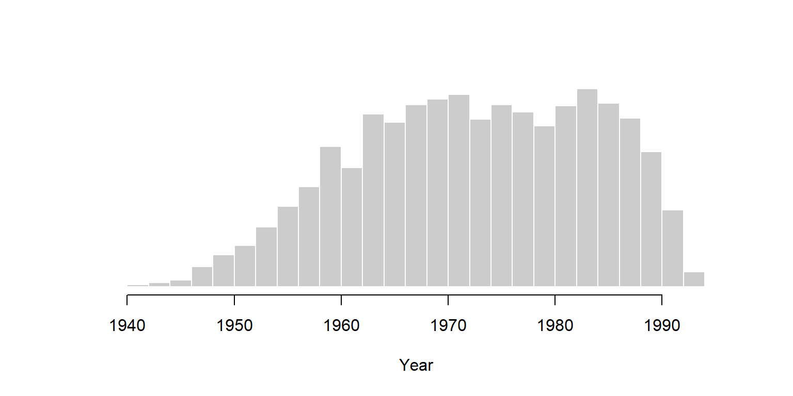{width=768}


::: 

:::::  


 

::: {.div1} 

#### birthMonth

<p class="dg-vlabel">month of birth (Mon)</p>

::: 

::::: {.parent} 

::: {.div3} 


<div class="dg-field"><span class="dg-k">DATA MODE</span><span class="dg-v">temporal</span></div>


<div class="dg-field"><span class="dg-k">DATA TYPE</span><span class="dg-v">month_of_year</span></div>


<div class="dg-field"><span class="dg-k">MAX NCHAR</span><span class="dg-v"> 3</span></div>


::: 

::: {.div4} 


<div class="dg-field"><span class="dg-k">DESCRIPTION</span><span class="dg-v">Month in which the player was born, as a three-letter abbreviation (Jan-Dec)</span></div>


::: 

::: {.div5} 

**PREVIEW**:


::: 

::: {.div6} 

<pre class="dg-preview">
Aug · Oct · Sep · Nov · Mar · May · Jan · Apr · Dec · Feb · Jun
Jul

</pre>


::: 

::: {.div7} 

**PROPERTIES**: 

|STAT     |   VAL|    PER| 
 |:--------|-----:|------:| 
 |Rows     | 4,620|       | 
 |Distinct |    12| (0.3%)| 


::: 

::: {.div8} 

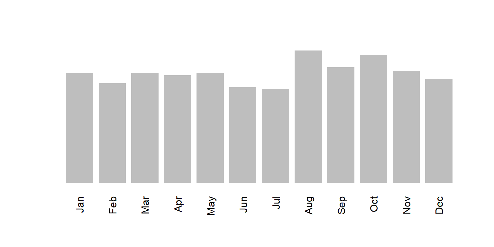{width=768}


::: 

:::::  


 

::: {.div1} 

#### debut

<p class="dg-vlabel">date of first appearance</p>

::: 

::::: {.parent} 

::: {.div3} 


<div class="dg-field"><span class="dg-k">DATA MODE</span><span class="dg-v">temporal</span></div>


<div class="dg-field"><span class="dg-k">DATA TYPE</span><span class="dg-v">calendar</span></div>


<div class="dg-field"><span class="dg-k">MAX NCHAR</span><span class="dg-v">10</span></div>


::: 

::: {.div4} 


<div class="dg-field"><span class="dg-k">DESCRIPTION</span><span class="dg-v">Date of the player's first major league appearance (YYYY-MM-DD)</span></div>


::: 

::: {.div5} 

**PREVIEW**:


::: 

::: {.div6} 

<pre class="dg-preview">
1995-04-26 · 2003-04-02 · 1998-03-31 · 2003-03-31 · 2006-04-03
2007-04-02 · 1996-04-03 · 2005-04-04 · 2011-09-06 · 1992-09-01
1995-04-27 · 1995-04-29 · 1998-04-02 · 1999-04-05 · 1999-04-06
1994-04-04 · 1995-04-28 · 1995-04-30 · 1999-04-07 · 2007-09-01

</pre>


::: 

::: {.div7} 

**PROPERTIES**: 

|STAT     |   VAL|     PER| 
 |:--------|-----:|-------:| 
 |Rows     | 4,620|        | 
 |Distinct | 2,948| (63.8%)| 


::: 

::: {.div8} 

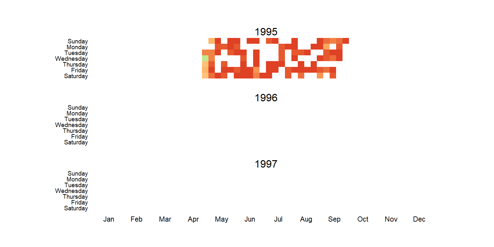{width=768}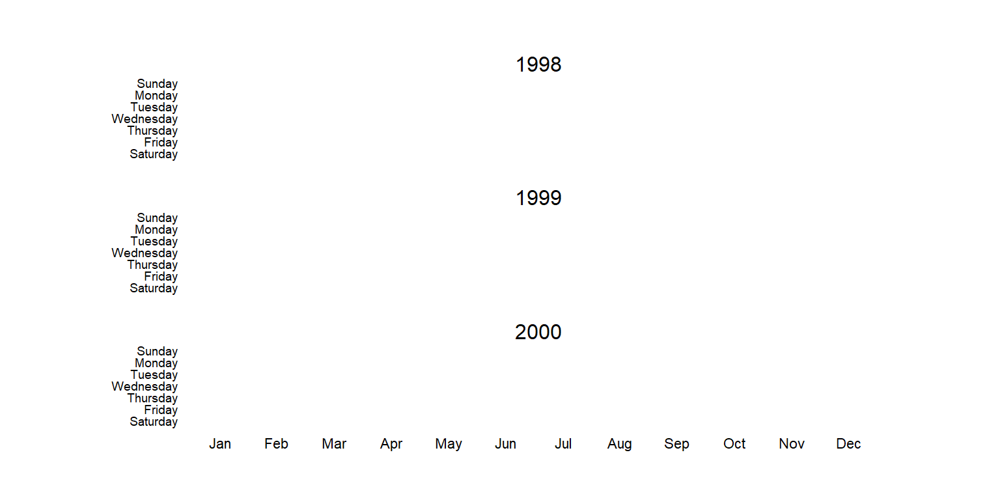{width=768}{width=768}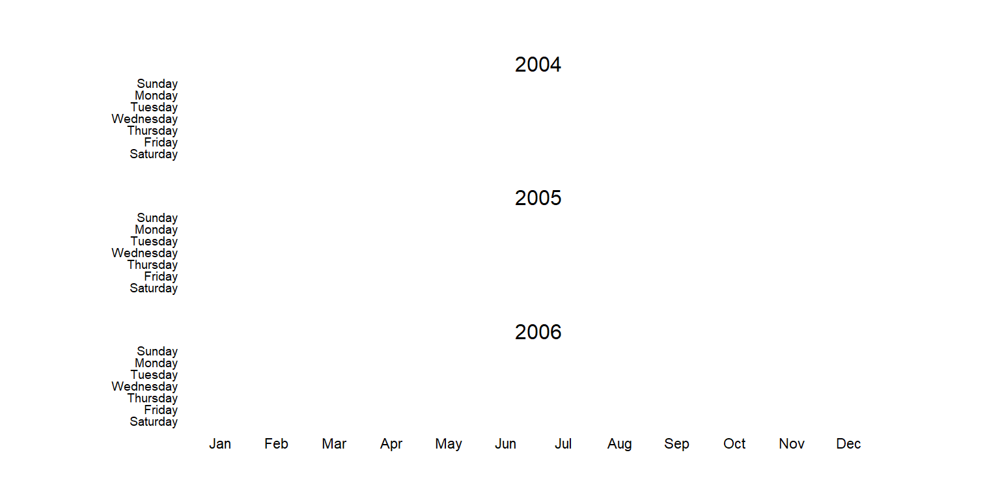{width=768}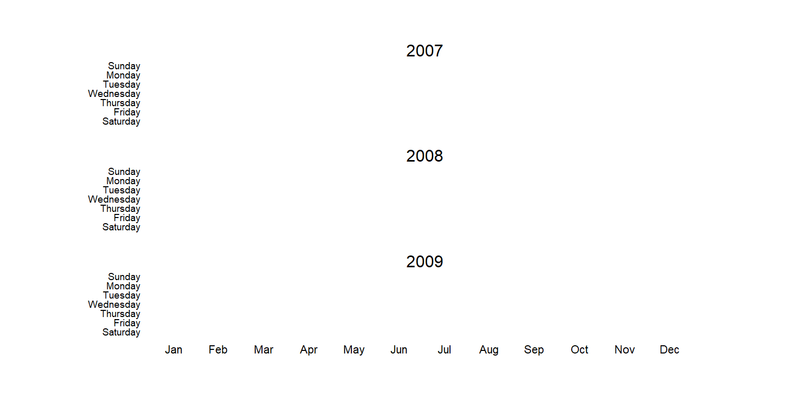{width=768}

```
Warning in lattice::trellis.panelArgs(): Plot spans multiple pages, only last
page can be updated
Warning in lattice::trellis.panelArgs(): Plot spans multiple pages, only last
page can be updated
```

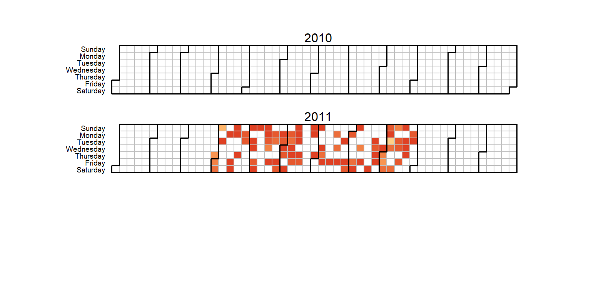{width=768}


::: 

:::::  


 

::: {.div1} 

#### finalGame

<p class="dg-vlabel">date of last appearance</p>

::: 

::::: {.parent} 

::: {.div3} 


<div class="dg-field"><span class="dg-k">DATA MODE</span><span class="dg-v">temporal</span></div>


<div class="dg-field"><span class="dg-k">DATA TYPE</span><span class="dg-v">calendar</span></div>


<div class="dg-field"><span class="dg-k">MAX NCHAR</span><span class="dg-v">10</span></div>


::: 

::: {.div4} 


<div class="dg-field"><span class="dg-k">DESCRIPTION</span><span class="dg-v">Date of the player's last major league appearance (YYYY-MM-DD)</span></div>


::: 

::: {.div5} 

**PREVIEW**:


::: 

::: {.div6} 

<pre class="dg-preview">
2022-10-05 · 2022-10-04 · 1999-10-03 · 2001-10-07 · 2009-10-04
2000-10-01 · 2007-09-30 · 1996-09-29 · 2010-10-03 · 2017-10-01
2012-10-03 · 2016-10-02 · 1998-09-27 · 2003-09-28 · 2013-09-29
2015-10-04 · 2014-09-28 · 2018-09-30 · 2005-10-02 · 1987-10-04

</pre>


::: 

::: {.div7} 

**PROPERTIES**: 

|STAT     |   VAL|     PER| 
 |:--------|-----:|-------:| 
 |Rows     | 4,620|        | 
 |Distinct | 2,320| (50.2%)| 


::: 

::: {.div8} 

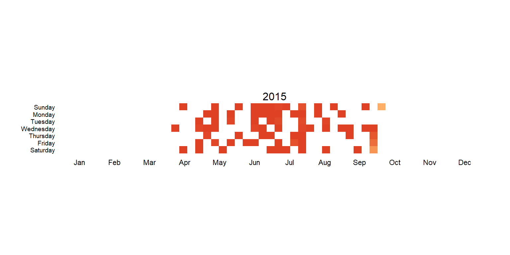{width=768}{width=768}{width=768}{width=768}{width=768}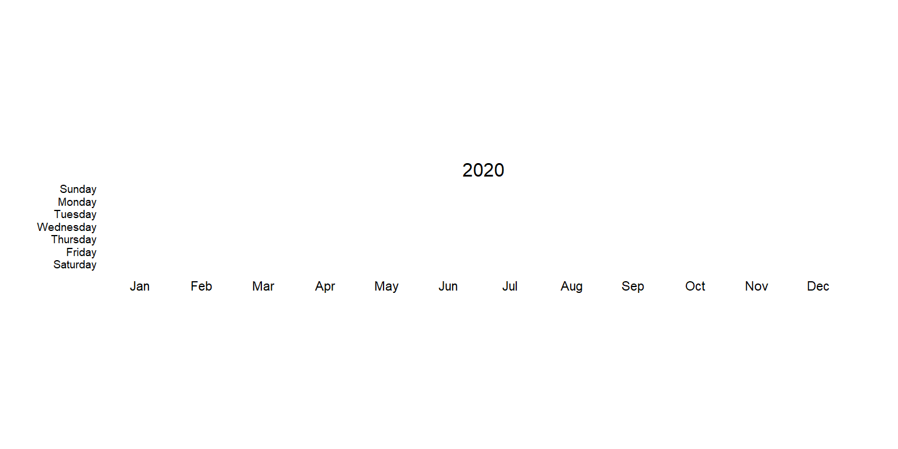{width=768}{width=768}

```
Warning in lattice::trellis.panelArgs(): Plot spans multiple pages, only last
page can be updated
```

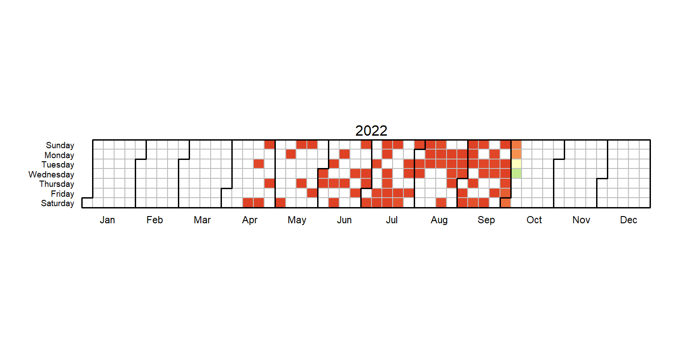{width=768}


::: 

:::::  


<style>
 /* ==========================================================================
   datagoodr report stylesheet
   Single source of truth for the RG / DD templates (served via datagoodr_css()).
   Tweak the tokens in :root to restyle the whole report.
   ========================================================================== */

:root {
  --dg-serif: Georgia, "Times New Roman", serif;
  --dg-sans:  -apple-system, "Segoe UI", Helvetica, Arial, sans-serif;
  --dg-mono:  "Anonymous Pro", Consolas, Menlo, monospace;

  --dg-ink:    #1a1a1a;   /* primary text            */
  --dg-label:  #6b6b6b;   /* field / section labels  */
  --dg-muted:  #8a8a8a;   /* secondary text          */
  --dg-rule:   #dcdcdc;   /* hairline table rules     */
  --dg-accent: #1a1a1a;   /* title underline          */

  --dg-gap-row: 6px;
  --dg-gap-col: 26px;
}

/* --- per-variable grid ---------------------------------------------------- */
/* Three equal columns. Each section (a div) is placed by flow, in layout
   order, and sized with `grid-column: span N` -> 1/3, 2/3, or full width.
   The div number stays the section's identity + style hook; only the span
   sets width. Keep each visual row's spans summing to 3 (1+2, 1+1+1, 3). */
.parent {
  display: grid;
  width: 100%;
  box-sizing: border-box;
  /* the whole grid is indented under the flush-left variable title (which is
     emitted outside .parent), matching the reference layout. */
  padding-left: 3.2em;
  /* minmax(0, 1fr) keeps the three columns strictly equal and lets wide
     content (long preview lines, wide tables) overflow instead of blowing
     out a column. */
  grid-template-columns: repeat(3, minmax(0, 1fr));
  grid-auto-rows: auto;
  grid-column-gap: var(--dg-gap-col);
  grid-row-gap: var(--dg-gap-row);
  /* breathing room after each variable block, before the next section title */
  margin-bottom: 2.2em;
}

/* keep every rendered graphic inside its cell - never overflow the column */
.parent img, .parent svg {
  max-width: 100%;
  height: auto;
}

/* Standard section template - one div scheme shared by every variable type:
     div3 attributes (1/3)  + div4 description (2/3)
     div5 PREVIEW label (1/3) + div6 preview data (2/3)
     div7 PROPERTIES (1/3)  + div8 graphic (2/3)
     div9 full-width extra table (3/3): STATS / levels / most-common values */
.div1  { grid-column: span 3; padding-bottom: 4px; }  /* title (outside grid) */
.div2  { grid-column: span 3; }   /* label            */
.div3  { grid-column: span 1; }   /* type/scope/length */
.div4  { grid-column: span 2; }   /* description       */
.div5  { grid-column: span 1; }   /* preview label     */
.div6  { grid-column: span 2; }   /* preview data      */
.div7  { grid-column: span 1; }   /* properties        */
.div8  { grid-column: span 2; }   /* graphic           */
.div9  { grid-column: span 3; }   /* full-width table  */

/* empty spacers usable directly from a layout object (e.g. "blank1") */
.blank1 { grid-column: span 1; }
.blank2 { grid-column: span 2; }

/* left-hand column cells get a small indent to sit under the title's text */
.div3, .div5, .div7 { padding-left: 2px; }

/* PROPERTIES (div7) shares a row with the tall word cloud (div8). The cell
   still stretches to the row height (so the band rule below aligns at the top),
   but its content is centered vertically to sit level with the graphic. */
.div7 { display: flex; flex-direction: column; justify-content: center; }

/* Band separators: a full-width hairline + breathing room at the start of each
   major block (preview / properties+graphic / stats). Applying the rule to both
   cells of a row spans it across all three columns (grid items stretch, so the
   tops align). The dictionary block (div2/div3/div4) gets no top rule. */
.div5, .div6,          /* PREVIEW band         */
.div7, .div8,          /* PROPERTIES + graphic */
.div9 {                /* stats / most-common  */
  border-top: 1px solid var(--dg-rule);
  padding-top: 0.9em;
  margin-top: 0.5em;
}

/* the full-width extra table is height-capped and scrolls when long (e.g. a
   factor with many levels, or a long most-common-values list) */
.div9 { max-height: 22em; overflow-y: auto; }

/* ==========================================================================
   Visual hierarchy
   L1 title  >  L2 label  >  L3 field labels  >  L4 values/data
   ========================================================================== */

/* L1 - variable name */
h1.title { color: var(--dg-ink); font-family: var(--dg-serif); font-size: 2.3em; }
h2.anchored { color: #c9c9c9; }
h3.anchored { color: var(--dg-muted); }

/* Title row: variable name + its plain-language label on one line, sharing
   one full-width rule. Wraps the label under the name when space runs out. */
.div1 {
  display: flex;
  flex-wrap: wrap;
  align-items: baseline;
  column-gap: 0.9em;
  row-gap: 0.1em;
  border-bottom: 2px solid var(--dg-accent);
  /* extra top margin sets each variable's title apart from the block above */
  margin: 2em 0 0.6em 0;
  padding-bottom: 4px;
}

h4 {
  font-family: var(--dg-mono);   /* a variable name is code: show it as code */
  font-size: 1.55em;
  font-weight: 700;
  letter-spacing: 0;
  color: var(--dg-ink);
  margin: 0;
  overflow-wrap: anywhere;       /* very long names wrap, never overflow */
}

/* L2 - the plain-language variable label, beside the name */
.div1 .dg-vlabel {
  font-family: var(--dg-serif);
  font-size: 1.2em;
  font-style: italic;
  color: var(--dg-label);
  line-height: 1.3;
  margin: 0;
}

h5 { font-size: 0.9em; }

/* L2 - the plain-language variable label (div2), printed without a prefix */
.div2 p {
  font-family: var(--dg-sans);
  font-size: 1.3em;
  font-weight: 400;
  color: var(--dg-ink);
  line-height: 1.3;
  margin: 0.1em 0 0.5em 0;
}

/* L3 - field & section labels (DATA TYPE:, DEFINITION:, LEVELS:, ...) rendered
   as <strong>. One consistent treatment across all descriptor divs. */
.div3 strong, .div4 strong {
  font-family: var(--dg-sans);
  text-transform: uppercase;
  letter-spacing: 0.04em;
  font-size: 0.72em;
  font-weight: 700;
  color: var(--dg-label);
}

/* L4 - values */
.div3 p {
  font-family: var(--dg-sans);
  font-size: 0.95em;
  color: var(--dg-ink);
  line-height: 1.2;
  margin: 0 0 0.15em 0;
}

.div4 p {
  font-family: var(--dg-sans);
  font-size: 0.95em;
  color: var(--dg-ink);
  line-height: 1.4;
  margin: 0 0 0.55em 0;
}

/* --- descriptor fields (v_to_txt) ----------------------------------------- */
/* Emitted as <div class="dg-field"><span class="dg-k">LABEL</span>
   <span class="dg-v">value</span></div>. div3 = short metadata aligned into a
   two-column definition block (dark label + bold mono value); div4 = uppercase
   label followed by flowing prose (e.g. DESCRIPTION). */
.dg-field .dg-k {
  font-family: var(--dg-sans);
  text-transform: uppercase;
  letter-spacing: 0.04em;
  font-size: 0.72em;
  font-weight: 700;
}

/* div3 is a 1/3 grid cell: min-width 0 lets it shrink to its track, and long
   values (e.g. a semantic type like "percentage_change") wrap inside it rather
   than bleeding into the DESCRIPTION column. */
.div3 { min-width: 0; }
.div3 .dg-field {
  display: grid;
  grid-template-columns: 6.6em minmax(0, 1fr);
  align-items: baseline;
  column-gap: 0.5em;
  margin: 0 0 0.32em 0;
}
.div3 .dg-k { color: var(--dg-label); white-space: nowrap; }
.div3 .dg-v {
  font-family: var(--dg-mono);
  font-weight: 700;
  font-size: 0.92em;
  color: var(--dg-ink);
  min-width: 0;
  overflow-wrap: anywhere;
}

.div4 .dg-field { margin: 0 0 0.55em 0; line-height: 1.4; }
.div4 .dg-k { color: var(--dg-label); }
.div4 .dg-k::after { content: ":\00a0"; }
.div4 .dg-v {
  font-family: var(--dg-sans);
  font-size: 0.95em;
  color: var(--dg-ink);
}

/* --- data preview: wrapped monospace block (wrap_preview / paste_preview) -- */
pre.dg-preview {
  font-family: var(--dg-mono);
  font-size: 0.7em;
  line-height: 1.4;
  white-space: pre;
  overflow-x: auto;      /* contain any stray long line inside the cell */
  max-width: 100%;
  background: none;
  border: none;
  padding: 0;
  margin: 0.15em 0 0 0;
  color: #333;
}

/* ==========================================================================
   Data-profile tables (properties / quantiles / stats)
   ========================================================================== */

/* section labels: div5 (PREVIEW), div7 (PROPERTIES), div9 (STATS/levels/...) */
.div5 p, .div7 p, .div9 p {
  margin: 0 0 0.15em 0;
}
.div5 strong, .div7 strong, .div9 strong {
  font-family: var(--dg-sans);
  text-transform: uppercase;
  letter-spacing: 0.04em;
  font-size: 0.72em;
  font-weight: 700;
  color: var(--dg-label);
}

/* mono cells in the properties (div7), graphic-cell table (div8, the identifier
   MOST COMMON VALUES table), and full-width (div9) tables. div8 is a graphic for
   every other type, so these table rules only bite for the identifier. */
.div7 td, .div8 td, .div9 td {
  font-family: var(--dg-mono);
  font-size: 0.85em;
}

.div7 table, .div8 table, .div9 table { margin-left: 2px; }

/* strip default table chrome; use tight cells + hairline row rules */
.table { width: auto; }
.table > tbody { border-top: none; }
.table > :not(caption) > * > * { padding: 0.05rem 0.6rem 0.05rem 0; }

tbody, tfoot, tr, td, th {
  border-color: inherit;
  border-style: none;
  border-width: 0;
}

.div7 tr, .div8 tr, .div9 tr {
  border-bottom: 1px solid var(--dg-rule);
}
/* hide the header on the self-evident STAT/VAL/PER properties table ... */
.div7 th { display: none; }
/* ... but keep it on the div8 identifier table and the full-width extra table,
   where the columns aren't self-evident (STATS names, factor
   LABEL/FREQUENCY/MEANING, most-common VALUE/FREQUENCY, logical category
   codes). */
.div8 th, .div9 th {
  font-family: var(--dg-sans);
  text-transform: uppercase;
  letter-spacing: 0.03em;
  font-size: 0.7em;
  font-weight: 700;
  color: var(--dg-label);
  text-align: left;
}

/* the DISTRIBUTION SHAPE table (numeric div9, under STATS) is self-evident, so
   its header (stat / num / interpretation) is hidden - same treatment as the
   PROPERTIES table. */
.dg-shape thead, .dg-shape th { display: none; }

/* graphic anchored to the bottom-right of its cell */
.div8 img, .div8 svg { align-self: end; justify-self: end; }

/* ==========================================================================
   Responsive: the three-column grid needs real width. Below ~640px (phones,
   split-screen or narrow windows) collapse it to a single column so every
   block stacks full-width, in source order. Without this a 1/3-width div3 is
   too thin to hold its 6.2em field label plus value, and the value bleeds
   across into the neighbouring cell.
   ========================================================================== */
@media (max-width: 640px) {
  .parent {
    grid-template-columns: 1fr;
    padding-left: 0;                /* reclaim the flush-left title indent */
  }
  /* span every cell across the single column (grid-column: span N would create
     phantom implicit columns); this keeps one full-width block per row. */
  .div1, .div2, .div3, .div4, .div5, .div6, .div7, .div8, .div9,
  .blank1, .blank2 { grid-column: 1 / -1; }
}

/* very narrow (small phones / long values): stack each field's label above its
   value so a long value can never overrun the fixed label column. */
@media (max-width: 400px) {
  .div3 .dg-field { grid-template-columns: 1fr; column-gap: 0; row-gap: 0.05em; }
}

@media print {
  body {
    display: table;
    table-layout: fixed;
    padding: 2.5cm 1.5cm 3cm 1.5cm;
    height: auto;
  }
} 
</style>


<!-- datagoodr-render-record {"datagoodr":"0.1.0","rendered_utc":"2026-10-28T06:10:17Z","r":"4.5.3","quarto":"1.8.25","dgf_file":"DGF.xlsx","dgf_hash":"7531091c035e093a9656f08e43e79722","dgf_variables":19} -->
