<!-- datagoodr research guide template.

     Customize without editing the package:
       - DG.R           custom functions & layout overrides
       - datagoodr.css  the page grid, fonts, and colors
     See vignette("customizing", package = "datagoodr").

     Render from the console with:  quarto::quarto_render("research-guide.qmd")
     or re-render against a different DGF/dataset without editing this file:
       datagoodr::update_rg("research-guide.qmd", DGF = "DGF-V2.xlsx") -->

 

  

## Logical

 

::: {.div1} 

#### vs

engine shape

::: 

::::: {.parent} 

::: {.div3} 

DATA MODEboolean

MAX NCHAR1

::: 

::: {.div4} 

DESCRIPTIONEngine shape: 0 = V-shaped, 1 = straight (inline)

::: 

::: {.div5} 

**PREVIEW**:

::: 

::: {.div6} 

<pre class="dg-preview">
0 · 1

</pre>

::: 

::: {.div7} 

**PROPERTIES**: 

|STAT     | VAL|    PER| 
 |:--------|---:|------:| 
 |Rows     |  32|       | 
 |Distinct |   2| (6.2%)| 

::: 

::: {.div8} 

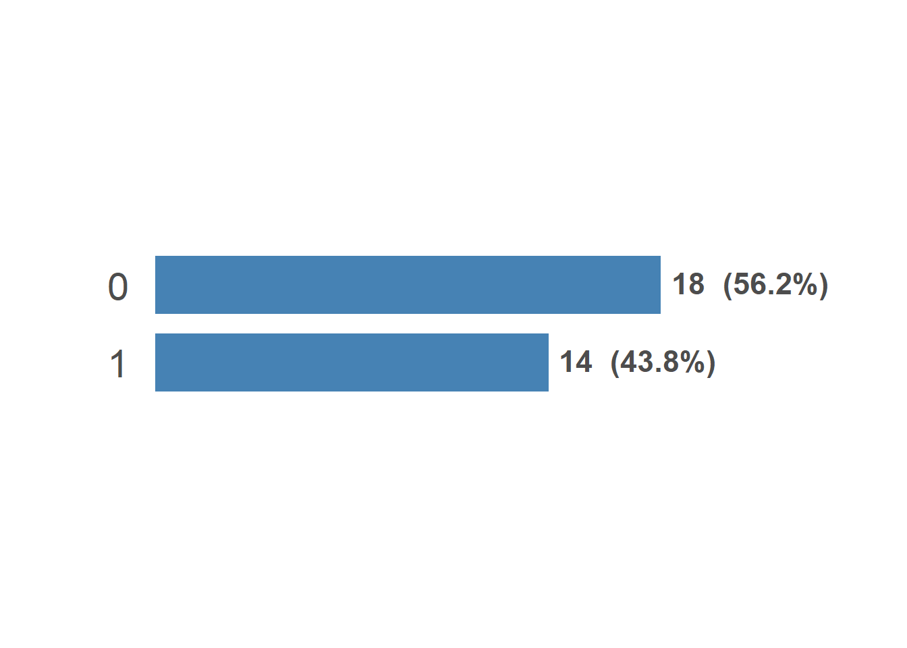{width=672}

::: 

::: {.div9} 

**CATEGORY LABELS**:

|0            |1            | 
 |:------------|:------------| 
 |0 (V-shaped) |1 (straight) | 

::: 

:::::  

 

::: {.div1} 

#### am

transmission

::: 

::::: {.parent} 

::: {.div3} 

DATA MODEboolean

MAX NCHAR1

::: 

::: {.div4} 

DESCRIPTIONTransmission: 0 = automatic, 1 = manual

::: 

::: {.div5} 

**PREVIEW**:

::: 

::: {.div6} 

<pre class="dg-preview">
0 · 1

</pre>

::: 

::: {.div7} 

**PROPERTIES**: 

|STAT     | VAL|    PER| 
 |:--------|---:|------:| 
 |Rows     |  32|       | 
 |Distinct |   2| (6.2%)| 

::: 

::: {.div8} 

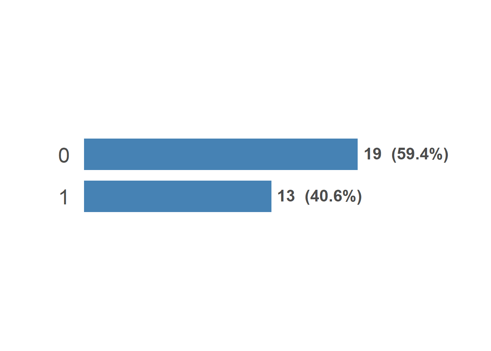{width=672}

::: 

::: {.div9} 

**CATEGORY LABELS**:

|0             |1          | 
 |:-------------|:----------| 
 |0 (automatic) |1 (manual) | 

::: 

:::::  

## Factor

 

::: {.div1} 

#### make

manufacturer

::: 

::::: {.parent} 

::: {.div3} 

DATA MODEcategorical

MAX NCHAR8

::: 

::: {.div4} 

DESCRIPTIONCar manufacturer, split from the mtcars row names

::: 

::: {.div5} 

**PREVIEW**:

::: 

::: {.div6} 

<pre class="dg-preview">
Merc · Fiat · Hornet · Mazda · Toyota · AMC · Cadillac · Camaro
Chrysler · Datsun · Dodge · Duster · Ferrari · Ford · Honda
Lincoln · Lotus · Maserati · Pontiac · Porsche · Valiant · Volvo

</pre>

::: 

::: {.div7} 

**PROPERTIES**: 

|STAT     | VAL|     PER| 
 |:--------|---:|-------:| 
 |Rows     |  32|        | 
 |Distinct |  22| (68.8%)| 

::: 

::: {.div8} 

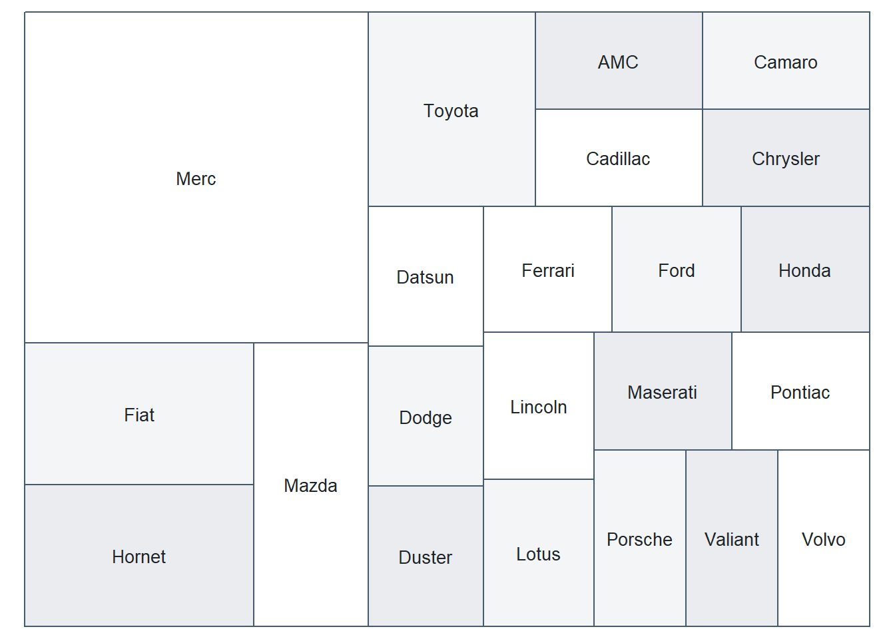{width=672}

::: 

::: {.div9} 

**FACTOR LEVELS**:

| Frequency|     (%)|Label    | 
 |---------:|-------:|:--------| 
 |         7| (21.9%)|Merc     | 
 |         2|  (6.2%)|Fiat     | 
 |         2|  (6.2%)|Hornet   | 
 |         2|  (6.2%)|Mazda    | 
 |         2|  (6.2%)|Toyota   | 
 |         1|  (3.1%)|AMC      | 
 |         1|  (3.1%)|Cadillac | 
 |         1|  (3.1%)|Camaro   | 
 |         1|  (3.1%)|Chrysler | 
 |         1|  (3.1%)|Datsun   | 
 |         1|  (3.1%)|Dodge    | 
 |         1|  (3.1%)|Duster   | 
 |         1|  (3.1%)|Ferrari  | 
 |         1|  (3.1%)|Ford     | 
 |         1|  (3.1%)|Honda    | 
 |         1|  (3.1%)|Lincoln  | 
 |         1|  (3.1%)|Lotus    | 
 |         1|  (3.1%)|Maserati | 
 |         1|  (3.1%)|Pontiac  | 
 |         1|  (3.1%)|Porsche  | 
 |         1|  (3.1%)|Valiant  | 
 |         1|  (3.1%)|Volvo    | 

::: 

:::::  

## Numeric 

 

::: {.div1} 

#### mpg

miles per gallon

::: 

::::: {.parent} 

::: {.div3} 

DATA MODEnumber

DATA TYPEmeasurement

MAX NCHAR4

::: 

::: {.div4} 

DESCRIPTIONFuel economy in miles per (US) gallon

::: 

::: {.div5} 

**PREVIEW**:

::: 

::: {.div6} 

<pre class="dg-preview">
10.4 · 15.2 · 19.2 · 21 · 21.4 · 22.8 · 30.4 · 13.3 · 14.3 · 14.7
15 · 15.5 · 15.8 · 16.4 · 17.3 · 17.8 · 18.1 · 18.7 · 19.7 · 21.5
24.4 · 26 · 27.3 · 32.4 · 33.9

</pre>

::: 

::: {.div7} 

**PROPERTIES**: 

|STAT     | VAL|     PER| 
 |:--------|---:|-------:| 
 |Rows     |  32|        | 
 |Distinct |  25| (78.1%)| 

::: 

::: {.div8} 

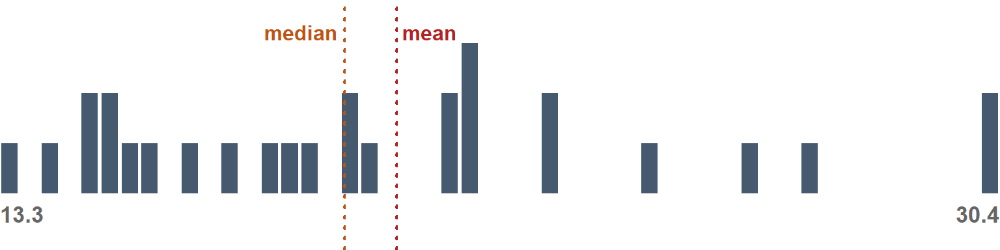{width=768}

::: 

::: {.div9} 

**STATS**:

|  MIN| Q05|   Q25|  Q50|  MEAN|  Q75|  Q95|  MAX| 
 |----:|---:|-----:|----:|-----:|----:|----:|----:| 
 | 10.4|  12| 15.43| 19.2| 20.09| 22.8| 31.3| 33.9| 

**DISTRIBUTION SHAPE**:

::: {.dg-shape}

|stat     |   num|interpretation | 
 |:--------|-----:|:--------------| 
 |Skew     |  0.61|MED            | 
 |Kurtosis | -0.37|LOW            | 

::: 

::: 

:::::  

 

::: {.div1} 

#### cyl

cylinders

::: 

::::: {.parent} 

::: {.div3} 

DATA MODEnumber

DATA TYPErank

MAX NCHAR1

::: 

::: {.div4} 

DESCRIPTIONNumber of engine cylinders

::: 

::: {.div5} 

**PREVIEW**:

::: 

::: {.div6} 

<pre class="dg-preview">
8 · 4 · 6

</pre>

::: 

::: {.div7} 

**PROPERTIES**: 

|STAT     | VAL|    PER| 
 |:--------|---:|------:| 
 |Rows     |  32|       | 
 |Distinct |   3| (9.4%)| 

::: 

::: {.div8} 

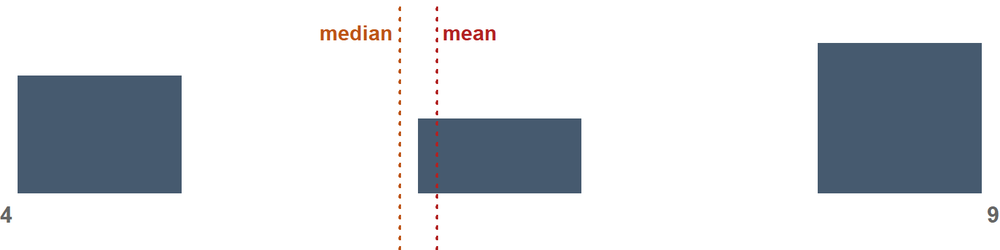{width=768}

::: 

::: {.div9} 

**STATS**:

| MIN| Q05| Q25| Q50| MEAN| Q75| Q95| MAX| 
 |---:|---:|---:|---:|----:|---:|---:|---:| 
 |   4|   4|   4|   6| 6.19|   8|   8|   8| 

**DISTRIBUTION SHAPE**:

::: {.dg-shape}

|stat     |   num|interpretation | 
 |:--------|-----:|:--------------| 
 |Skew     | -0.17|LOW            | 
 |Kurtosis | -1.76|MED            | 

::: 

::: 

:::::  

 

::: {.div1} 

#### disp

displacement (cu. in.)

::: 

::::: {.parent} 

::: {.div3} 

DATA MODEnumber

DATA TYPEmeasurement

MAX NCHAR5

::: 

::: {.div4} 

DESCRIPTIONEngine displacement in cubic inches

::: 

::: {.div5} 

**PREVIEW**:

::: 

::: {.div6} 

<pre class="dg-preview">
275.8 · 160 · 167.6 · 360 · 71.1 · 75.7 · 78.7 · 79 · 95.1 · 108
120.1 · 120.3 · 121 · 140.8 · 145 · 146.7 · 225 · 258 · 301 · 304
318 · 350 · 351 · 400 · 440 · 460 · 472

</pre>

::: 

::: {.div7} 

**PROPERTIES**: 

|STAT     | VAL|     PER| 
 |:--------|---:|-------:| 
 |Rows     |  32|        | 
 |Distinct |  27| (84.4%)| 

::: 

::: {.div8} 

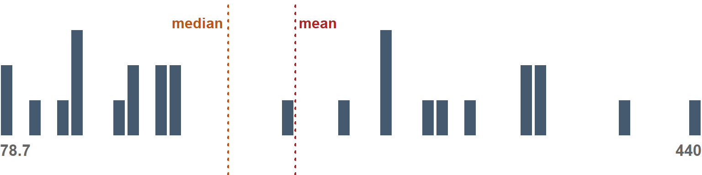{width=768}

::: 

::: {.div9} 

**STATS**:

|  MIN|   Q05|    Q25|   Q50|   MEAN| Q75| Q95| MAX| 
 |----:|-----:|------:|-----:|------:|---:|---:|---:| 
 | 71.1| 77.35| 120.83| 196.3| 230.72| 326| 449| 472| 

**DISTRIBUTION SHAPE**:

::: {.dg-shape}

|stat     |   num|interpretation | 
 |:--------|-----:|:--------------| 
 |Skew     |  0.38|LOW            | 
 |Kurtosis | -1.21|MED            | 

::: 

::: 

:::::  

 

::: {.div1} 

#### hp

gross horsepower

::: 

::::: {.parent} 

::: {.div3} 

DATA MODEnumber

DATA TYPEcount

MAX NCHAR3

::: 

::: {.div4} 

DESCRIPTIONGross horsepower

::: 

::: {.div5} 

**PREVIEW**:

::: 

::: {.div6} 

<pre class="dg-preview">
110 · 175 · 180 · 66 · 123 · 150 · 245 · 52 · 62 · 65 · 91 · 93 · 95
97 · 105 · 109 · 113 · 205 · 215 · 230 · 264 · 335

</pre>

::: 

::: {.div7} 

**PROPERTIES**: 

|STAT     | VAL|     PER| 
 |:--------|---:|-------:| 
 |Rows     |  32|        | 
 |Distinct |  22| (68.8%)| 

::: 

::: {.div8} 

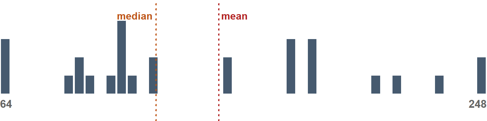{width=768}

::: 

::: {.div9} 

**STATS**:

| MIN|   Q05|  Q25| Q50|   MEAN| Q75|    Q95| MAX| 
 |---:|-----:|----:|---:|------:|---:|------:|---:| 
 |  52| 63.65| 96.5| 123| 146.69| 180| 253.55| 335| 

**DISTRIBUTION SHAPE**:

::: {.dg-shape}

|stat     |   num|interpretation | 
 |:--------|-----:|:--------------| 
 |Skew     |  0.73|MED            | 
 |Kurtosis | -0.14|LOW            | 

::: 

::: 

:::::  

 

::: {.div1} 

#### drat

rear axle ratio

::: 

::::: {.parent} 

::: {.div3} 

DATA MODEnumber

DATA TYPEmeasurement

MAX NCHAR4

::: 

::: {.div4} 

DESCRIPTIONRear axle ratio

::: 

::: {.div5} 

**PREVIEW**:

::: 

::: {.div6} 

<pre class="dg-preview">
3.07 · 3.92 · 2.76 · 3.08 · 3.15 · 3.9 · 4.08 · 4.22 · 2.93 · 3
3.21 · 3.23 · 3.54 · 3.62 · 3.69 · 3.7 · 3.73 · 3.77 · 3.85 · 4.11
4.43 · 4.93

</pre>

::: 

::: {.div7} 

**PROPERTIES**: 

|STAT     | VAL|     PER| 
 |:--------|---:|-------:| 
 |Rows     |  32|        | 
 |Distinct |  22| (68.8%)| 

::: 

::: {.div8} 

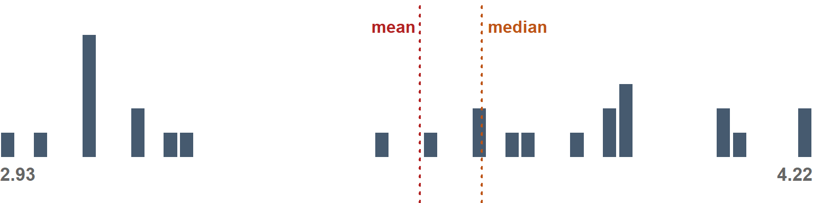{width=768}

::: 

::: {.div9} 

**STATS**:

|  MIN|  Q05|  Q25| Q50| MEAN|  Q75|  Q95|  MAX| 
 |----:|----:|----:|---:|----:|----:|----:|----:| 
 | 2.76| 2.85| 3.08| 3.7|  3.6| 3.92| 4.31| 4.93| 

**DISTRIBUTION SHAPE**:

::: {.dg-shape}

|stat     |   num|interpretation | 
 |:--------|-----:|:--------------| 
 |Skew     |  0.27|LOW            | 
 |Kurtosis | -0.71|LOW            | 

::: 

::: 

:::::  

 

::: {.div1} 

#### wt

weight (1,000 lbs)

::: 

::::: {.parent} 

::: {.div3} 

DATA MODEnumber

DATA TYPEmeasurement

MAX NCHAR5

::: 

::: {.div4} 

DESCRIPTIONVehicle weight in thousands of pounds

::: 

::: {.div5} 

**PREVIEW**:

::: 

::: {.div6} 

<pre class="dg-preview">
3.44 · 3.57 · 1.513 · 1.615 · 1.835 · 1.935 · 2.14 · 2.2 · 2.32
2.465 · 2.62 · 2.77 · 2.78 · 2.875 · 3.15 · 3.17 · 3.19 · 3.215
3.435 · 3.46 · 3.52 · 3.73 · 3.78 · 3.84 · 3.845 · 4.07 · 5.25
5.345 · 5.424

</pre>

::: 

::: {.div7} 

**PROPERTIES**: 

|STAT     | VAL|     PER| 
 |:--------|---:|-------:| 
 |Rows     |  32|        | 
 |Distinct |  29| (90.6%)| 

::: 

::: {.div8} 

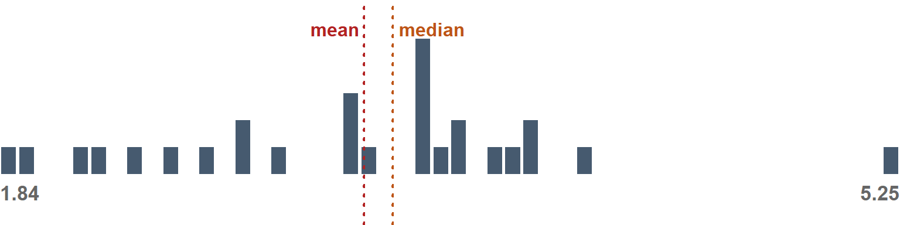{width=768}

::: 

::: {.div9} 

**STATS**:

|  MIN|  Q05|  Q25|  Q50| MEAN|  Q75|  Q95|  MAX| 
 |----:|----:|----:|----:|----:|----:|----:|----:| 
 | 1.51| 1.74| 2.58| 3.33| 3.22| 3.61| 5.29| 5.42| 

**DISTRIBUTION SHAPE**:

::: {.dg-shape}

|stat     |   num|interpretation | 
 |:--------|-----:|:--------------| 
 |Skew     |  0.42|LOW            | 
 |Kurtosis | -0.02|LOW            | 

::: 

::: 

:::::  

 

::: {.div1} 

#### qsec

quarter-mile time (sec)

::: 

::::: {.parent} 

::: {.div3} 

DATA MODEnumber

DATA TYPEmeasurement

MAX NCHAR5

::: 

::: {.div4} 

DESCRIPTIONFastest quarter-mile time from a standing start, in seconds

::: 

::: {.div5} 

**PREVIEW**:

::: 

::: {.div6} 

<pre class="dg-preview">
17.02 · 18.9 · 14.5 · 14.6 · 15.41 · 15.5 · 15.84 · 16.46 · 16.7
16.87 · 16.9 · 17.05 · 17.3 · 17.4 · 17.42 · 17.6 · 17.82 · 17.98
18 · 18.3 · 18.52 · 18.6 · 18.61 · 19.44 · 19.47 · 19.9 · 20 · 20.01
20.22 · 22.9

</pre>

::: 

::: {.div7} 

**PROPERTIES**: 

|STAT     | VAL|     PER| 
 |:--------|---:|-------:| 
 |Rows     |  32|        | 
 |Distinct |  30| (93.8%)| 

::: 

::: {.div8} 

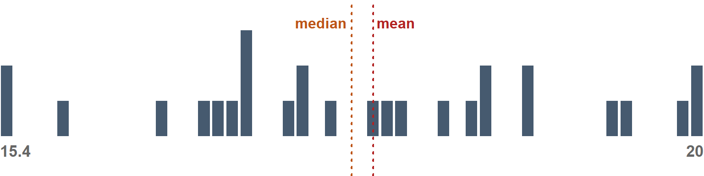{width=768}

::: 

::: {.div9} 

**STATS**:

|  MIN|   Q05|   Q25|   Q50|  MEAN|  Q75|  Q95|  MAX| 
 |----:|-----:|-----:|-----:|-----:|----:|----:|----:| 
 | 14.5| 15.05| 16.89| 17.71| 17.85| 18.9| 20.1| 22.9| 

**DISTRIBUTION SHAPE**:

::: {.dg-shape}

|stat     |  num|interpretation | 
 |:--------|----:|:--------------| 
 |Skew     | 0.37|LOW            | 
 |Kurtosis | 0.34|LOW            | 

::: 

::: 

:::::  

 

::: {.div1} 

#### gear

forward gears

::: 

::::: {.parent} 

::: {.div3} 

DATA MODEnumber

DATA TYPErank

MAX NCHAR1

::: 

::: {.div4} 

DESCRIPTIONNumber of forward gears

::: 

::: {.div5} 

**PREVIEW**:

::: 

::: {.div6} 

<pre class="dg-preview">
3 · 4 · 5

</pre>

::: 

::: {.div7} 

**PROPERTIES**: 

|STAT     | VAL|    PER| 
 |:--------|---:|------:| 
 |Rows     |  32|       | 
 |Distinct |   3| (9.4%)| 

::: 

::: {.div8} 

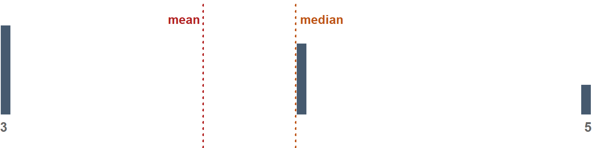{width=768}

::: 

::: {.div9} 

**STATS**:

| MIN| Q05| Q25| Q50| MEAN| Q75| Q95| MAX| 
 |---:|---:|---:|---:|----:|---:|---:|---:| 
 |   3|   3|   3|   4| 3.69|   4|   5|   5| 

**DISTRIBUTION SHAPE**:

::: {.dg-shape}

|stat     |   num|interpretation | 
 |:--------|-----:|:--------------| 
 |Skew     |  0.53|MED            | 
 |Kurtosis | -1.07|MED            | 

::: 

::: 

:::::  

 

::: {.div1} 

#### carb

carburetors

::: 

::::: {.parent} 

::: {.div3} 

DATA MODEnumber

MAX NCHAR1

::: 

::: {.div4} 

DESCRIPTIONNumber of carburetors

::: 

::: {.div5} 

**PREVIEW**:

::: 

::: {.div6} 

<pre class="dg-preview">
2 · 4 · 1 · 3 · 6 · 8

</pre>

::: 

::: {.div7} 

**PROPERTIES**: 

|STAT     | VAL|     PER| 
 |:--------|---:|-------:| 
 |Rows     |  32|        | 
 |Distinct |   6| (18.8%)| 

::: 

::: {.div8} 

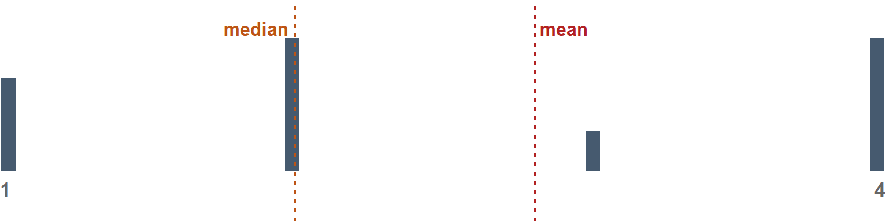{width=768}

::: 

::: {.div9} 

**STATS**:

| MIN| Q05| Q25| Q50| MEAN| Q75| Q95| MAX| 
 |---:|---:|---:|---:|----:|---:|---:|---:| 
 |   1|   1|   2|   2| 2.81|   4| 4.9|   8| 

**DISTRIBUTION SHAPE**:

::: {.dg-shape}

|stat     |  num|interpretation | 
 |:--------|----:|:--------------| 
 |Skew     | 1.05|HIGH           | 
 |Kurtosis | 1.26|MED            | 

::: 

::: 

:::::  

## Character

## Identifier

 

::: {.div1} 

#### model

::: 

::::: {.parent} 

::: {.div3} 

DATA MODEidentifier

MAX NCHAR11

::: 

::: {.div4} 

DESCRIPTIONCar model, split from the mtcars row names

::: 

::: {.div5} 

**PREVIEW**:

::: 

::: {.div6} 

<pre class="dg-preview">
128 · 142E · 230 · 240D · 280 · 280C · 360 · 4 Drive · 450SE · 450SL
450SLC · 710 · 914-2 · Bora · Challenger · Civic · Continental
Corolla · Corona · Dino · Europa · Firebird · Fleetwood · Imperial
Javelin · Pantera L · RX4 · RX4 Wag · Sportabout · X1-9 · Z28

</pre>

::: 

::: {.div7} 

**PROPERTIES**: 

|STAT          | VAL|      PER| 
 |:-------------|---:|--------:| 
 |Rows          |  32|         | 
 |Distinct      |  32| (100.0%)| 
 |Missing/Empty |   1|   (3.1%)| 

::: 

::: {.div8} 

**MOST COMMON VALUES**: 

|Value | Frequency|    (%)| 
 |:-----|---------:|------:| 
 |128   |         1| (3.1%)| 
 |142E  |         1| (3.1%)| 
 |230   |         1| (3.1%)| 
 |240D  |         1| (3.1%)| 
 |280   |         1| (3.1%)| 
 |280C  |         1| (3.1%)| 

::: 

:::::  

## Temporal

<!-- datagoodr-render-record {"datagoodr":"0.1.0","rendered_utc":"2026-10-28T07:12:09Z","r":"4.5.3","quarto":"1.8.25","dgf_file":"DGF.xlsx","dgf_hash":"a9872d22fd9f5413d70fa1e160d8dc27","dgf_variables":13} -->
