<!-- datagoodr research guide template.

     Customize without editing the package:
       - DG.R           custom functions & layout overrides
       - datagoodr.css  the page grid, fonts, and colors
     See vignette("customizing", package = "datagoodr").

     Render from the console with:  quarto::quarto_render("research-guide.qmd")
     or re-render against a different DGF/dataset without editing this file:
       datagoodr::update_rg("research-guide.qmd", DGF = "DGF-V2.xlsx") -->

 

  

## Logical

## Factor

 

::: {.div1} 

#### hair_color

::: 

::::: {.parent} 

::: {.div3} 

DATA MODEcategorical

DATA TYPEgeographic

MAX NCHAR 13

::: 

::: {.div4} 

::: 

::: {.div5} 

**PREVIEW**:

::: 

::: {.div6} 

<pre class="dg-preview">
none · brown · black · white · blond · auburn · auburn, grey
auburn, white · blonde · brown, grey · grey

</pre>

::: 

::: {.div7} 

**PROPERTIES**: 

|STAT       | VAL|     PER| 
 |:----------|---:|-------:| 
 |Rows       |  87|        | 
 |Distinct   |  12| (13.8%)| 
 |Missing/NA |   5|  (5.7%)| 

::: 

::: {.div8} 

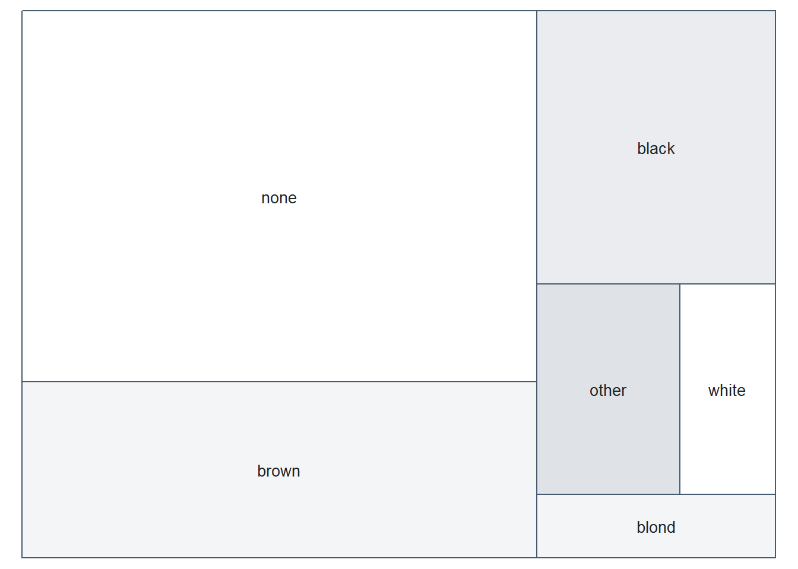{width=672}

::: 

::: {.div9} 

**FACTOR LEVELS**:

| Frequency|     (%)|Label         | 
 |---------:|-------:|:-------------| 
 |        38| (43.7%)|none          | 
 |        18| (20.7%)|brown         | 
 |        13| (14.9%)|black         | 
 |         4|  (4.6%)|white         | 
 |         3|  (3.4%)|blond         | 
 |         1|  (1.1%)|auburn        | 
 |         1|  (1.1%)|auburn, grey  | 
 |         1|  (1.1%)|auburn, white | 
 |         1|  (1.1%)|blonde        | 
 |         1|  (1.1%)|brown, grey   | 
 |         1|  (1.1%)|grey          | 

::: 

:::::  

 

::: {.div1} 

#### eye_color

::: 

::::: {.parent} 

::: {.div3} 

DATA MODEcategorical

DATA TYPEgeographic

MAX NCHAR 13

::: 

::: {.div4} 

::: 

::: {.div5} 

**PREVIEW**:

::: 

::: {.div6} 

<pre class="dg-preview">
brown · blue · yellow · black · orange · red · hazel · unknown
blue-gray · dark · gold · green, yellow · pink · red, blue · white

</pre>

::: 

::: {.div7} 

**PROPERTIES**: 

|STAT     | VAL|     PER| 
 |:--------|---:|-------:| 
 |Rows     |  87|        | 
 |Distinct |  15| (17.2%)| 

::: 

::: {.div8} 

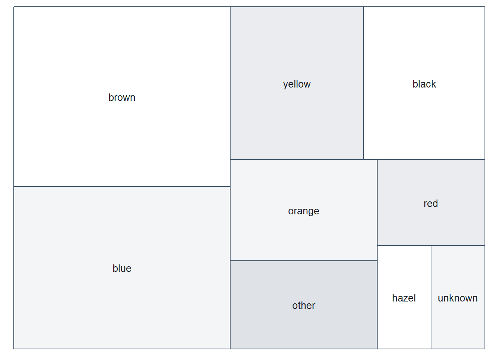{width=672}

::: 

::: {.div9} 

**FACTOR LEVELS**:

| Frequency|     (%)|Label         | 
 |---------:|-------:|:-------------| 
 |        21| (24.1%)|brown         | 
 |        19| (21.8%)|blue          | 
 |        11| (12.6%)|yellow        | 
 |        10| (11.5%)|black         | 
 |         8|  (9.2%)|orange        | 
 |         5|  (5.7%)|red           | 
 |         3|  (3.4%)|hazel         | 
 |         3|  (3.4%)|unknown       | 
 |         1|  (1.1%)|blue-gray     | 
 |         1|  (1.1%)|dark          | 
 |         1|  (1.1%)|gold          | 
 |         1|  (1.1%)|green, yellow | 
 |         1|  (1.1%)|pink          | 
 |         1|  (1.1%)|red, blue     | 
 |         1|  (1.1%)|white         | 

::: 

:::::  

 

::: {.div1} 

#### sex

::: 

::::: {.parent} 

::: {.div3} 

DATA MODEcategorical

DATA TYPEunordered

MAX NCHAR 14

::: 

::: {.div4} 

::: 

::: {.div5} 

**PREVIEW**:

::: 

::: {.div6} 

<pre class="dg-preview">
male · female · none · hermaphroditic

</pre>

::: 

::: {.div7} 

**PROPERTIES**: 

|STAT       | VAL|    PER| 
 |:----------|---:|------:| 
 |Rows       |  87|       | 
 |Distinct   |   5| (5.7%)| 
 |Missing/NA |   4| (4.6%)| 

::: 

::: {.div8} 

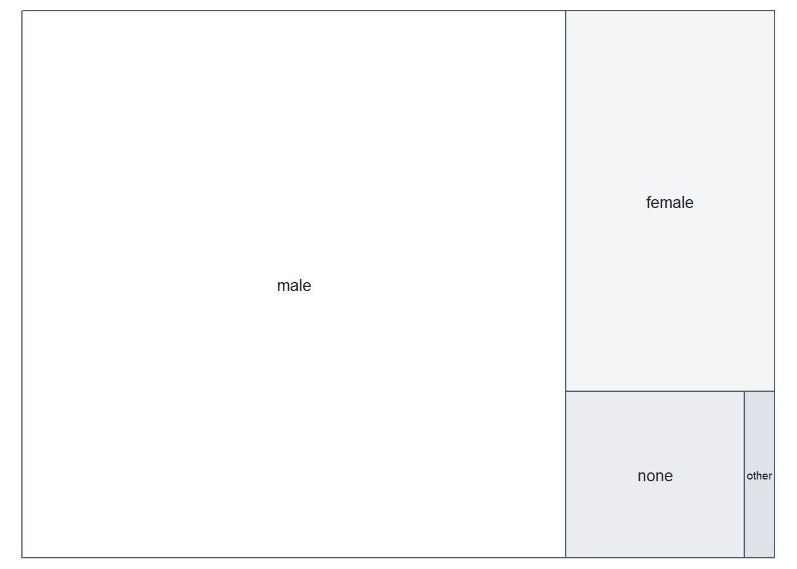{width=672}

::: 

::: {.div9} 

**FACTOR LEVELS**:

| Frequency|     (%)|Label          | 
 |---------:|-------:|:--------------| 
 |        60| (69.0%)|male           | 
 |        16| (18.4%)|female         | 
 |         6|  (6.9%)|none           | 
 |         1|  (1.1%)|hermaphroditic | 

::: 

:::::  

 

::: {.div1} 

#### gender

::: 

::::: {.parent} 

::: {.div3} 

DATA MODEcategorical

DATA TYPEunordered

MAX NCHAR  9

::: 

::: {.div4} 

::: 

::: {.div5} 

**PREVIEW**:

::: 

::: {.div6} 

<pre class="dg-preview">
masculine · feminine

</pre>

::: 

::: {.div7} 

**PROPERTIES**: 

|STAT       | VAL|    PER| 
 |:----------|---:|------:| 
 |Rows       |  87|       | 
 |Distinct   |   3| (3.4%)| 
 |Missing/NA |   4| (4.6%)| 

::: 

::: {.div8} 

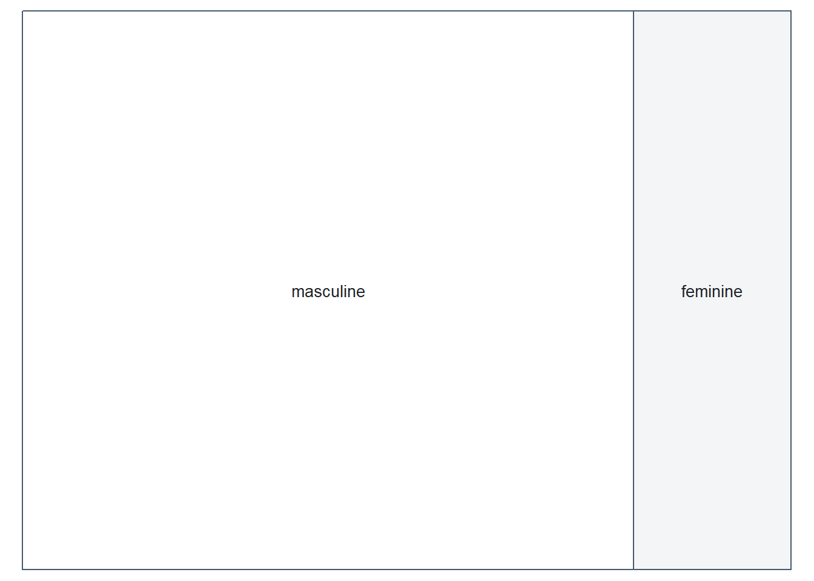{width=672}

::: 

::: {.div9} 

**FACTOR LEVELS**:

| Frequency|     (%)|Label     | 
 |---------:|-------:|:---------| 
 |        66| (75.9%)|masculine | 
 |        17| (19.5%)|feminine  | 

::: 

:::::  

 

::: {.div1} 

#### homeworld

::: 

::::: {.parent} 

::: {.div3} 

DATA MODEcategorical

DATA TYPEgeographic

MAX NCHAR 14

::: 

::: {.div4} 

::: 

::: {.div5} 

**PREVIEW**:

::: 

::: {.div6} 

<pre class="dg-preview">
Naboo · Tatooine · Alderaan · Coruscant · Kamino · Corellia
Kashyyyk · Mirial · Ryloth · Aleen Minor · Bespin · Bestine IV
Cato Neimoidia · Cerea · Champala · Chandrila · Concord Dawn
Dathomir · Dorin · Endor · Eriadu · Geonosis · Glee Anselm

</pre>

::: 

::: {.div7} 

**PROPERTIES**: 

|STAT       | VAL|     PER| 
 |:----------|---:|-------:| 
 |Rows       |  87|        | 
 |Distinct   |  49| (56.3%)| 
 |Missing/NA |  10| (11.5%)| 

::: 

::: {.div8} 

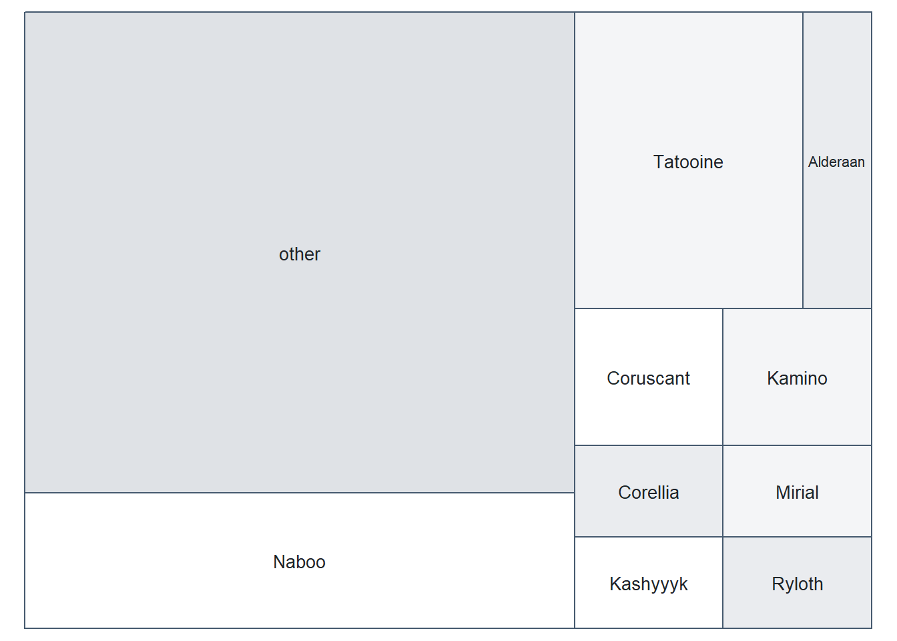{width=672}

::: 

::: {.div9} 

**FACTOR LEVELS**:

| Frequency|     (%)|Label          | 
 |---------:|-------:|:--------------| 
 |        11| (12.6%)|Naboo          | 
 |        10| (11.5%)|Tatooine       | 
 |         3|  (3.4%)|Alderaan       | 
 |         3|  (3.4%)|Coruscant      | 
 |         3|  (3.4%)|Kamino         | 
 |         2|  (2.3%)|Corellia       | 
 |         2|  (2.3%)|Kashyyyk       | 
 |         2|  (2.3%)|Mirial         | 
 |         2|  (2.3%)|Ryloth         | 
 |         1|  (1.1%)|Aleen Minor    | 
 |         1|  (1.1%)|Bespin         | 
 |         1|  (1.1%)|Bestine IV     | 
 |         1|  (1.1%)|Cato Neimoidia | 
 |         1|  (1.1%)|Cerea          | 
 |         1|  (1.1%)|Champala       | 
 |         1|  (1.1%)|Chandrila      | 
 |         1|  (1.1%)|Concord Dawn   | 
 |         1|  (1.1%)|Dathomir       | 
 |         1|  (1.1%)|Dorin          | 
 |         1|  (1.1%)|Endor          | 
 |         1|  (1.1%)|Eriadu         | 
 |         1|  (1.1%)|Geonosis       | 
 |         1|  (1.1%)|Glee Anselm    | 
 |         1|  (1.1%)|Haruun Kal     | 
 |         1|  (1.1%)|Iktotch        | 
 |         1|  (1.1%)|Iridonia       | 
 |         1|  (1.1%)|Kalee          | 
 |         1|  (1.1%)|Malastare      | 
 |         1|  (1.1%)|Mon Cala       | 
 |         1|  (1.1%)|Muunilinst     | 
 |         1|  (1.1%)|Nal Hutta      | 
 |         1|  (1.1%)|Ojom           | 
 |         1|  (1.1%)|Quermia        | 
 |         1|  (1.1%)|Rodia          | 
 |         1|  (1.1%)|Serenno        | 
 |         1|  (1.1%)|Shili          | 
 |         1|  (1.1%)|Skako          | 
 |         1|  (1.1%)|Socorro        | 
 |         1|  (1.1%)|Stewjon        | 
 |         1|  (1.1%)|Sullust        | 
 |         1|  (1.1%)|Toydaria       | 
 |         1|  (1.1%)|Trandosha      | 
 |         1|  (1.1%)|Troiken        | 
 |         1|  (1.1%)|Tund           | 
 |         1|  (1.1%)|Umbara         | 
 |         1|  (1.1%)|Utapau         | 
 |         1|  (1.1%)|Vulpter        | 
 |         1|  (1.1%)|Zolan          | 

::: 

:::::  

 

::: {.div1} 

#### films

::: 

::::: {.parent} 

::: {.div3} 

DATA MODEcategorical

MAX NCHAR131

::: 

::: {.div4} 

::: 

::: {.div5} 

**PREVIEW**:

::: 

::: {.div6} 

<pre class="dg-preview">
Attack of the Clones · The Phantom Menace
A New Hope|The Empire Strikes Back|Return of the
The Phantom Menace|Attack of the Clones|Revenge
Attack of the Clones|Revenge of the Sith · Return of the Jedi

</pre>

::: 

::: {.div7} 

**PROPERTIES**: 

|STAT     | VAL|     PER| 
 |:--------|---:|-------:| 
 |Rows     |  87|        | 
 |Distinct |  24| (27.6%)| 

::: 

::: {.div8} 

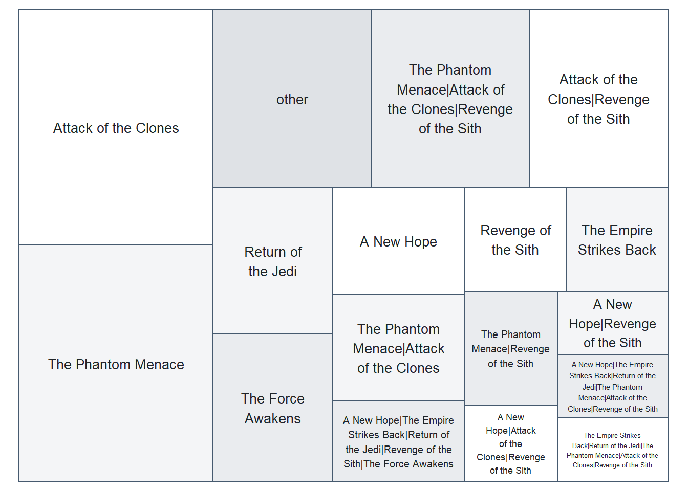{width=672}

::: 

::: {.div9} 

**FACTOR LEVELS**:

| Frequency|     (%)|Label                                                                                                                                                             | 
 |---------:|-------:|:-----------------------------------------------------------------------------------------------------------------------------------------------------------------| 
 |        13| (14.9%)|Attack of the Clones                                                                                                                                              | 
 |        13| (14.9%)|The Phantom Menace                                                                                                                                                | 
 |         8|  (9.2%)|The Phantom Menace&#124;Attack of the Clones&#124;Revenge of the Sith                                                                                             | 
 |         7|  (8.0%)|Attack of the Clones&#124;Revenge of the Sith                                                                                                                     | 
 |         5|  (5.7%)|Return of the Jedi                                                                                                                                                | 
 |         5|  (5.7%)|The Force Awakens                                                                                                                                                 | 
 |         4|  (4.6%)|A New Hope                                                                                                                                                        | 
 |         4|  (4.6%)|The Phantom Menace&#124;Attack of the Clones                                                                                                                      | 
 |         3|  (3.4%)|A New Hope&#124;The Empire Strikes Back&#124;Return of the Jedi&#124;Revenge of the Sith&#124;The Force Awakens                                                   | 
 |         3|  (3.4%)|Revenge of the Sith                                                                                                                                               | 
 |         3|  (3.4%)|The Empire Strikes Back                                                                                                                                           | 
 |         3|  (3.4%)|The Phantom Menace&#124;Revenge of the Sith                                                                                                                       | 
 |         2|  (2.3%)|A New Hope&#124;Attack of the Clones&#124;Revenge of the Sith                                                                                                     | 
 |         2|  (2.3%)|A New Hope&#124;Revenge of the Sith                                                                                                                               | 
 |         2|  (2.3%)|A New Hope&#124;The Empire Strikes Back&#124;Return of the Jedi&#124;The Phantom Menace&#124;Attack of the Clones&#124;Revenge of the Sith                        | 
 |         2|  (2.3%)|The Empire Strikes Back&#124;Return of the Jedi&#124;The Phantom Menace&#124;Attack of the Clones&#124;Revenge of the Sith                                        | 
 |         1|  (1.1%)|A New Hope&#124;Return of the Jedi&#124;The Phantom Menace                                                                                                        | 
 |         1|  (1.1%)|A New Hope&#124;The Empire Strikes Back&#124;Return of the Jedi                                                                                                   | 
 |         1|  (1.1%)|A New Hope&#124;The Empire Strikes Back&#124;Return of the Jedi&#124;Revenge of the Sith                                                                          | 
 |         1|  (1.1%)|A New Hope&#124;The Empire Strikes Back&#124;Return of the Jedi&#124;The Force Awakens                                                                            | 
 |         1|  (1.1%)|A New Hope&#124;The Empire Strikes Back&#124;Return of the Jedi&#124;The Phantom Menace&#124;Attack of the Clones&#124;Revenge of the Sith&#124;The Force Awakens | 
 |         1|  (1.1%)|Return of the Jedi&#124;The Force Awakens                                                                                                                         | 
 |         1|  (1.1%)|The Empire Strikes Back&#124;Return of the Jedi                                                                                                                   | 
 |         1|  (1.1%)|The Empire Strikes Back&#124;Return of the Jedi&#124;Attack of the Clones                                                                                         | 

::: 

:::::  

 

::: {.div1} 

#### vehicles

::: 

::::: {.parent} 

::: {.div3} 

DATA MODEcategorical

MAX NCHAR 35

::: 

::: {.div4} 

::: 

::: {.div5} 

**PREVIEW**:

::: 

::: {.div6} 

<pre class="dg-preview">
Tribubble bongo · AT-ST · Flitknot speeder · Imperial Speeder Bike
Koro-2 Exodrive airspeeder · Sith speeder · Snowspeeder
Snowspeeder|Imperial Speeder Bike · Tsmeu-6 personal wheel bike
Zephyr-G swoop bike|XJ-6 airspeeder

</pre>

::: 

::: {.div7} 

**PROPERTIES**: 

|STAT       | VAL|     PER| 
 |:----------|---:|-------:| 
 |Rows       |  87|        | 
 |Distinct   |  11| (12.6%)| 
 |Missing/NA |  76| (87.4%)| 

::: 

::: {.div8} 

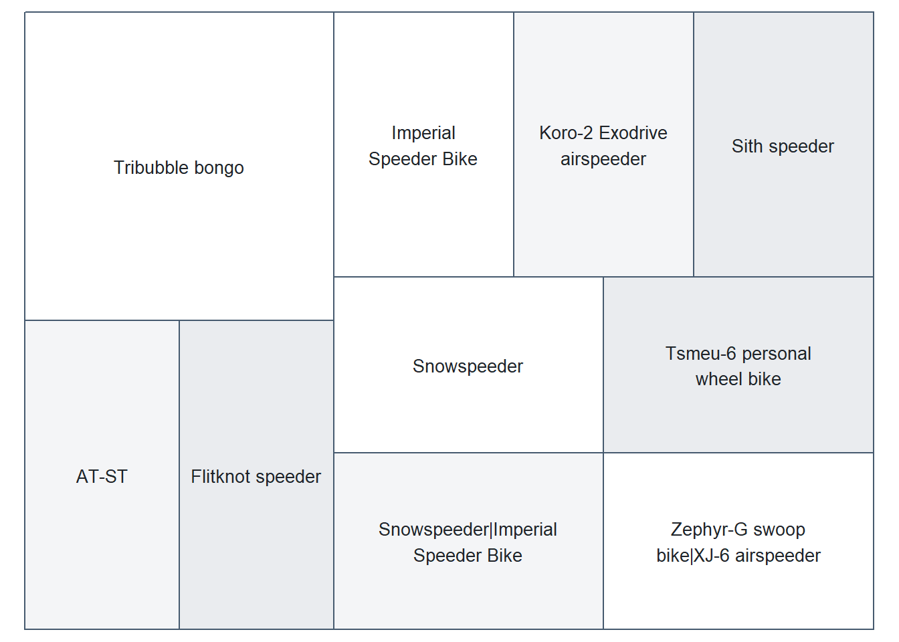{width=672}

::: 

::: {.div9} 

**FACTOR LEVELS**:

| Frequency|    (%)|Label                                    | 
 |---------:|------:|:----------------------------------------| 
 |         2| (2.3%)|Tribubble bongo                          | 
 |         1| (1.1%)|AT-ST                                    | 
 |         1| (1.1%)|Flitknot speeder                         | 
 |         1| (1.1%)|Imperial Speeder Bike                    | 
 |         1| (1.1%)|Koro-2 Exodrive airspeeder               | 
 |         1| (1.1%)|Sith speeder                             | 
 |         1| (1.1%)|Snowspeeder                              | 
 |         1| (1.1%)|Snowspeeder&#124;Imperial Speeder Bike   | 
 |         1| (1.1%)|Tsmeu-6 personal wheel bike              | 
 |         1| (1.1%)|Zephyr-G swoop bike&#124;XJ-6 airspeeder | 

::: 

:::::  

 

::: {.div1} 

#### starships

::: 

::::: {.parent} 

::: {.div3} 

DATA MODEcategorical

MAX NCHAR100

::: 

::: {.div4} 

::: 

::: {.div5} 

**PREVIEW**:

::: 

::: {.div6} 

<pre class="dg-preview">
X-wing · Millennium Falcon · Millennium Falcon|Imperial shuttle
A-wing · Belbullab-22 starfighter · Jedi starfighter
Jedi starfighter|Trade Federation cruiser|Naboo · Naboo fighter
Naboo fighter|H-type Nubian yacht|Naboo star ski

</pre>

::: 

::: {.div7} 

**PROPERTIES**: 

|STAT       | VAL|     PER| 
 |:----------|---:|-------:| 
 |Rows       |  87|        | 
 |Distinct   |  16| (18.4%)| 
 |Missing/NA |  67| (77.0%)| 

::: 

::: {.div8} 

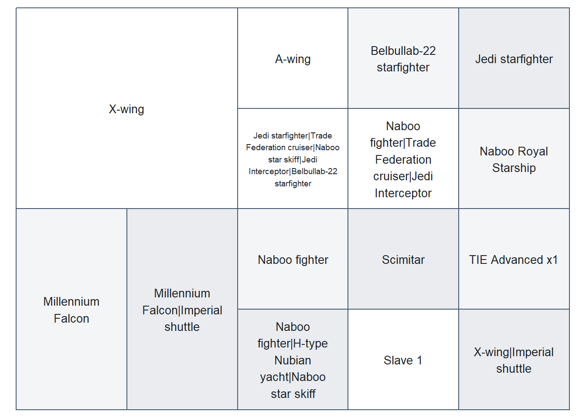{width=672}

::: 

::: {.div9} 

**FACTOR LEVELS**:

| Frequency|    (%)|Label                                                                                                                    | 
 |---------:|------:|:------------------------------------------------------------------------------------------------------------------------| 
 |         4| (4.6%)|X-wing                                                                                                                   | 
 |         2| (2.3%)|Millennium Falcon                                                                                                        | 
 |         2| (2.3%)|Millennium Falcon&#124;Imperial shuttle                                                                                  | 
 |         1| (1.1%)|A-wing                                                                                                                   | 
 |         1| (1.1%)|Belbullab-22 starfighter                                                                                                 | 
 |         1| (1.1%)|Jedi starfighter                                                                                                         | 
 |         1| (1.1%)|Jedi starfighter&#124;Trade Federation cruiser&#124;Naboo star skiff&#124;Jedi Interceptor&#124;Belbullab-22 starfighter | 
 |         1| (1.1%)|Naboo fighter                                                                                                            | 
 |         1| (1.1%)|Naboo fighter&#124;H-type Nubian yacht&#124;Naboo star skiff                                                             | 
 |         1| (1.1%)|Naboo fighter&#124;Trade Federation cruiser&#124;Jedi Interceptor                                                        | 
 |         1| (1.1%)|Naboo Royal Starship                                                                                                     | 
 |         1| (1.1%)|Scimitar                                                                                                                 | 
 |         1| (1.1%)|Slave 1                                                                                                                  | 
 |         1| (1.1%)|TIE Advanced x1                                                                                                          | 
 |         1| (1.1%)|X-wing&#124;Imperial shuttle                                                                                             | 

::: 

:::::  

## Numeric 

 

::: {.div1} 

#### height

::: 

::::: {.parent} 

::: {.div3} 

DATA MODEnumber

MAX NCHAR3

::: 

::: {.div4} 

::: 

::: {.div5} 

**PREVIEW**:

::: 

::: {.div6} 

<pre class="dg-preview">
183 · 180 · 188 · 170 · 178 · 175 · 191 · 193 · 196 · 96 · 150 · 163
165 · 167 · 185 · 198 · 206 · 66 · 79 · 88 · 94 · 97 · 112 · 122
137 · 157 · 160 · 166 · 168 · 171 · 172 · 173 · 177 · 182 · 184
190 · 200 · 202 · 213 · 216 · 224 · 228 · 229 · 234 · 264

</pre>

::: 

::: {.div7} 

**PROPERTIES**: 

|STAT       | VAL|     PER| 
 |:----------|---:|-------:| 
 |Rows       |  87|        | 
 |Distinct   |  46| (52.9%)| 
 |Missing/NA |   6|  (6.9%)| 

::: 

::: {.div8} 

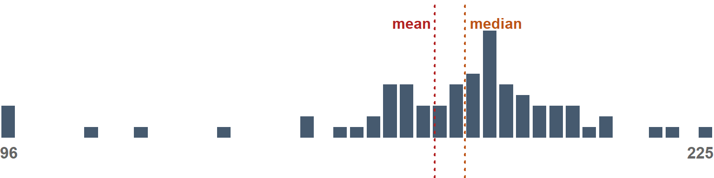{width=768}

::: 

::: {.div9} 

**STATS**:

| MIN| Q05| Q25| Q50|  MEAN| Q75| Q95| MAX| 
 |---:|---:|---:|---:|-----:|---:|---:|---:| 
 |  66|  96| 167| 180| 174.6| 191| 224| 264| 

**DISTRIBUTION SHAPE**:

::: {.dg-shape}

|stat     |   num|interpretation | 
 |:--------|-----:|:--------------| 
 |Skew     | -1.05|HIGH           | 
 |Kurtosis |   1.8|MED            | 

::: 

::: 

:::::  

 

::: {.div1} 

#### mass

::: 

::::: {.parent} 

::: {.div3} 

DATA MODEnumber

DATA TYPEmeasurement

MAX NCHAR4

::: 

::: {.div4} 

::: 

::: {.div5} 

**PREVIEW**:

::: 

::: {.div6} 

<pre class="dg-preview">
80 · 79 · 75 · 77 · 84 · 32 · 45 · 48 · 50 · 55 · 82 · 136 · 15 · 17
20 · 40 · 49 · 56.2 · 57 · 65 · 66 · 68 · 74 · 78.2 · 83 · 85 · 87
88 · 89 · 90 · 102 · 110 · 112 · 113 · 120 · 140 · 159 · 1358

</pre>

::: 

::: {.div7} 

**PROPERTIES**: 

|STAT       | VAL|     PER| 
 |:----------|---:|-------:| 
 |Rows       |  87|        | 
 |Distinct   |  39| (44.8%)| 
 |Missing/NA |  28| (32.2%)| 

::: 

::: {.div8} 

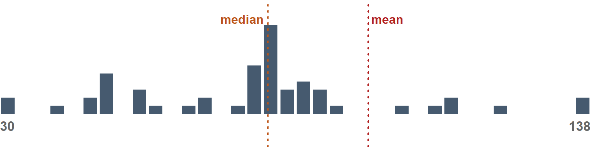{width=768}

::: 

::: {.div9} 

**STATS**:

| MIN|  Q05|  Q25| Q50|  MEAN|  Q75|   Q95|   MAX| 
 |---:|----:|----:|---:|-----:|----:|-----:|-----:| 
 |  15| 30.8| 55.6|  79| 97.31| 84.5| 136.4| 1,358| 

**DISTRIBUTION SHAPE**:

::: {.dg-shape}

|stat     |   num|interpretation | 
 |:--------|-----:|:--------------| 
 |Skew     |  6.97|HIGH           | 
 |Kurtosis | 48.93|HIGH           | 

::: 

::: 

:::::  

 

::: {.div1} 

#### birth_year

::: 

::::: {.parent} 

::: {.div3} 

DATA MODEnumber

MAX NCHAR4

::: 

::: {.div4} 

::: 

::: {.div5} 

**PREVIEW**:

::: 

::: {.div6} 

<pre class="dg-preview">
19 · 41.9 · 48 · 52 · 72 · 82 · 92 · 8 · 15 · 21 · 22 · 24 · 29 · 31
31.5 · 33 · 37 · 40 · 41 · 44 · 46 · 47 · 53 · 54 · 57 · 58 · 62
64 · 66 · 67 · 91 · 102 · 112 · 200 · 600 · 896

</pre>

::: 

::: {.div7} 

**PROPERTIES**: 

|STAT       | VAL|     PER| 
 |:----------|---:|-------:| 
 |Rows       |  87|        | 
 |Distinct   |  37| (42.5%)| 
 |Missing/NA |  44| (50.6%)| 

::: 

::: {.div8} 

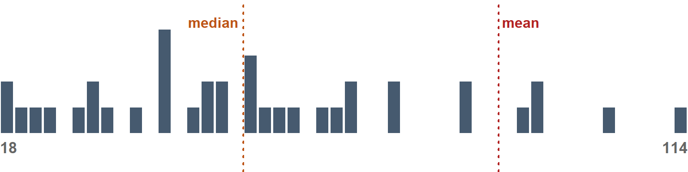{width=768}

::: 

::: {.div9} 

**STATS**:

| MIN| Q05| Q25| Q50|  MEAN| Q75|   Q95| MAX| 
 |---:|---:|---:|---:|-----:|---:|-----:|---:| 
 |   8|  19|  35|  52| 87.57|  72| 191.2| 896| 

**DISTRIBUTION SHAPE**:

::: {.dg-shape}

|stat     |   num|interpretation | 
 |:--------|-----:|:--------------| 
 |Skew     |  4.15|HIGH           | 
 |Kurtosis | 17.17|HIGH           | 

::: 

::: 

:::::  

## Character

 

::: {.div1} 

#### name

::: 

::::: {.parent} 

::: {.div3} 

DATA MODEtext

DATA TYPEorganization

MAX NCHAR21

::: 

::: {.div4} 

::: 

::: {.div5} 

**PREVIEW**:

::: 

::: {.div6} 

<pre class="dg-preview">
Ackbar · Adi Gallia · Anakin Skywalker · Arvel Crynyd · Ayla Secura
Bail Prestor Organa · Barriss Offee · BB8 · Ben Quadinaros
Beru Whitesun Lars · Bib Fortuna · Biggs Darklighter · Boba Fett
Bossk · C-3PO · Captain Phasma · Chewbacca · Cliegg Lars · Cordé

</pre>

::: 

::: {.div7} 

**PROPERTIES**: 

|STAT     | VAL|      PER| 
 |:--------|---:|--------:| 
 |Rows     |  87|         | 
 |Distinct |  87| (100.0%)| 

::: 

::: {.div8} 

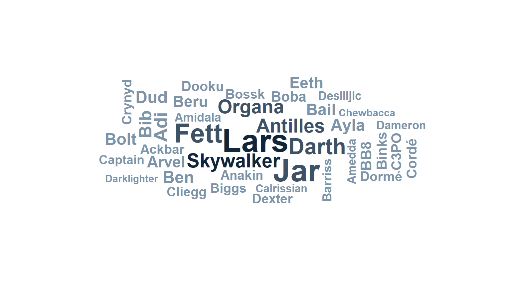{width=768}

::: 

::: {.div9} 

**MOST COMMON VALUES**: 

|Value               | Frequency|    (%)| 
 |:-------------------|---------:|------:| 
 |Ackbar              |         1| (1.1%)| 
 |Adi Gallia          |         1| (1.1%)| 
 |Anakin Skywalker    |         1| (1.1%)| 
 |Arvel Crynyd        |         1| (1.1%)| 
 |Ayla Secura         |         1| (1.1%)| 
 |Bail Prestor Organa |         1| (1.1%)| 

::: 

:::::  

 

::: {.div1} 

#### skin_color

::: 

::::: {.parent} 

::: {.div3} 

DATA MODEtext

MAX NCHAR19

::: 

::: {.div4} 

::: 

::: {.div5} 

**PREVIEW**:

::: 

::: {.div6} 

<pre class="dg-preview">
fair · light · dark · green · grey · pale · brown · blue
blue, grey · none · orange · tan · white · white, blue · yellow
brown mottle · brown, white · fair, green, yellow · gold
green-tan, brown · green, grey · grey, blue · grey, green, yellow

</pre>

::: 

::: {.div7} 

**PROPERTIES**: 

|STAT     | VAL|     PER| 
 |:--------|---:|-------:| 
 |Rows     |  87|        | 
 |Distinct |  31| (35.6%)| 

::: 

::: {.div8} 

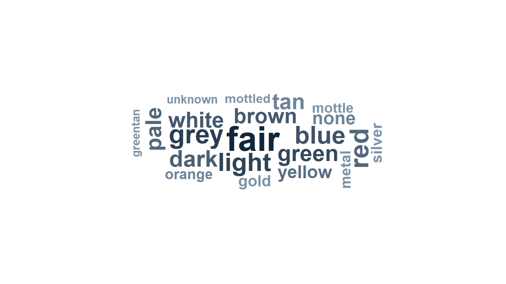{width=768}

::: 

::: {.div9} 

**MOST COMMON VALUES**: 

|Value | Frequency|     (%)| 
 |:-----|---------:|-------:| 
 |fair  |        17| (19.5%)| 
 |light |        11| (12.6%)| 
 |dark  |         6|  (6.9%)| 
 |green |         6|  (6.9%)| 
 |grey  |         6|  (6.9%)| 
 |pale  |         5|  (5.7%)| 

::: 

:::::  

 

::: {.div1} 

#### species

::: 

::::: {.parent} 

::: {.div3} 

DATA MODEtext

MAX NCHAR14

::: 

::: {.div4} 

::: 

::: {.div5} 

**PREVIEW**:

::: 

::: {.div6} 

<pre class="dg-preview">
Human · Droid · Gungan · Kaminoan · Mirialan · Twi'lek · Wookiee
Zabrak · Aleena · Besalisk · Cerean · Chagrian · Clawdite · Dug
Ewok · Geonosian · Hutt · Iktotchi · Kaleesh · Kel Dor
Mon Calamari · Muun · Nautolan · Neimodian · Pau'an · Quermian

</pre>

::: 

::: {.div7} 

**PROPERTIES**: 

|STAT       | VAL|     PER| 
 |:----------|---:|-------:| 
 |Rows       |  87|        | 
 |Distinct   |  38| (43.7%)| 
 |Missing/NA |   4|  (4.6%)| 

::: 

::: {.div8} 

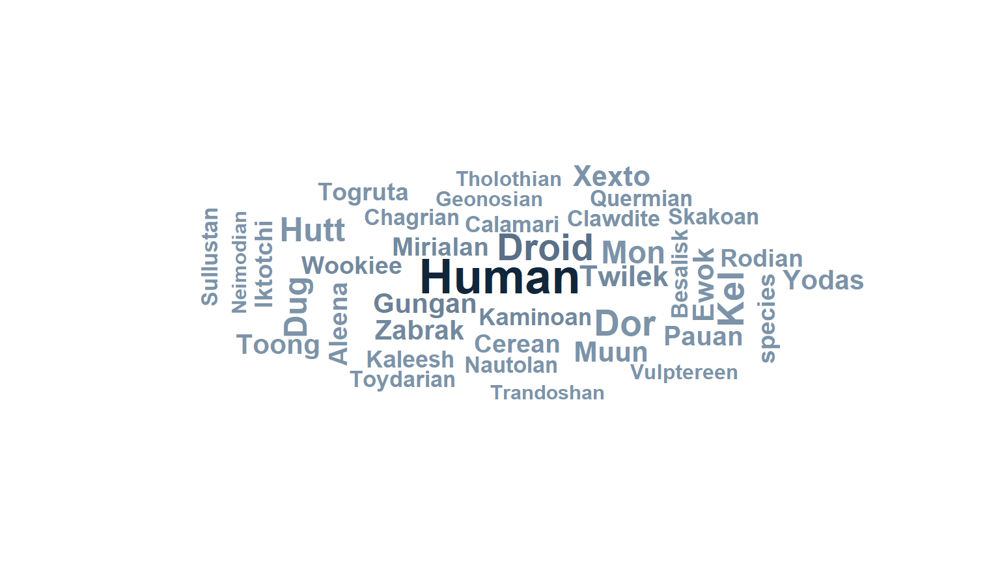{width=768}

::: 

::: {.div9} 

**MOST COMMON VALUES**: 

|Value    | Frequency|     (%)| 
 |:--------|---------:|-------:| 
 |Human    |        35| (40.2%)| 
 |Droid    |         6|  (6.9%)| 
 |Gungan   |         3|  (3.4%)| 
 |Kaminoan |         2|  (2.3%)| 
 |Mirialan |         2|  (2.3%)| 
 |Twi'lek  |         2|  (2.3%)| 

::: 

:::::  

## Identifier

## Temporal

<!-- datagoodr-render-record {"datagoodr":"0.1.0","rendered_utc":"2026-10-28T07:05:24Z","r":"4.5.3","quarto":"1.8.25","dgf_file":"DGF.xlsx","dgf_hash":"79c740edf2df783c6e4bb613d91d46f1","dgf_variables":14} -->
